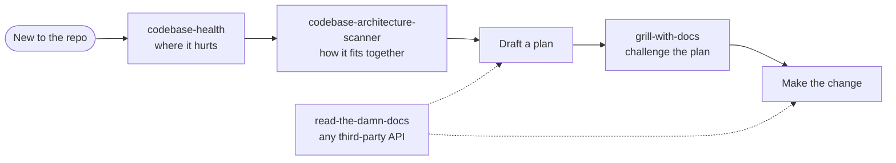
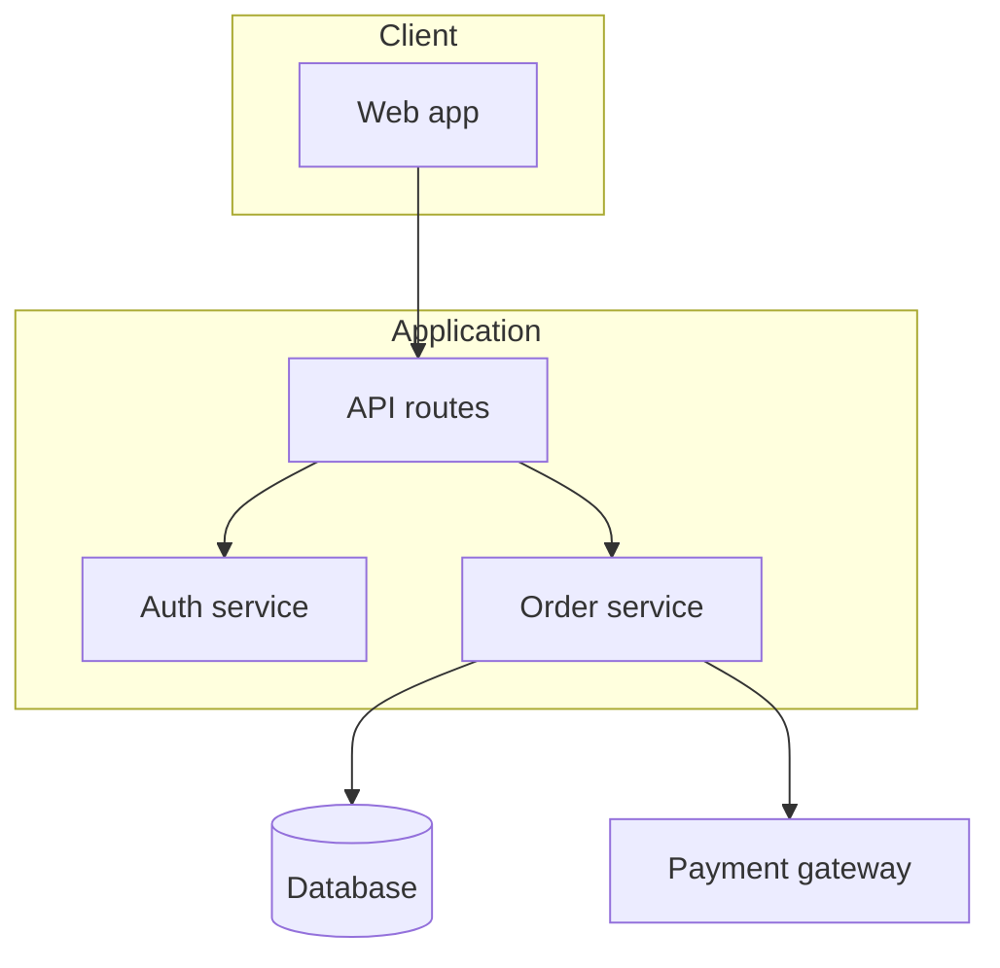

# Codebase Intelligence

Four skills for building an accurate picture of a codebase — and of the libraries it leans on — *before* committing to a change.

The failure these guard against is the same in both directions: acting on a mental model that was never checked. Inside the repo, that's refactoring around structure you assumed; outside it, that's calling an API the way you remember it working.

---

## The skills

| Skill | Use it when |
|---|---|
| `codebase-health` | Onboarding somewhere unfamiliar, planning a refactor, or diagnosing why one area keeps breaking. Reports complexity hotspots, churn, bus factor, and velocity from git history. |
| `codebase-architecture-scanner` | You need architecture documentation that doesn't exist yet — layered high-level and detailed docs, with C4 context and sequence diagrams. |
| `grill-with-docs` | A plan is drafted and needs challenging against the domain model that's already there, sharpening terminology and updating docs rather than inventing parallel vocabulary. |
| `read-the-damn-docs` | Anything touching a third-party API, library, framework, CLI, cloud service, or provider SDK. Goes to current documentation instead of trusting recall. |

---

## Rule ownership

| Skill | Owns |
|---|---|
| `codebase-health` | Quantitative repository signals — complexity, churn, hotspots, bus factor |
| `codebase-architecture-scanner` | Structural description — components, layers, boundaries, diagrams |
| `grill-with-docs` | Adversarial review of a plan against the existing domain model and terminology |
| `read-the-damn-docs` | Everything *outside* the repository — third-party behavior, versions, current APIs |

The split that matters most: **`codebase-health` measures, `codebase-architecture-scanner` describes.** Health tells you where the pain is concentrated; the scanner tells you how the thing is put together. Reach for health when deciding *whether* and *where* to change something, and the scanner when you need to explain the system to someone — including your future self.

`read-the-damn-docs` is the only one that looks outward, and it's the cheapest habit in the pack: a wrong assumption about a library's behavior survives code review, because reviewers assume it too.

---

## What it looks like

<details>
<summary>Compatibility at a glance</summary>

| Skill | Claude Code | Claude app | Codex | ChatGPT | Other agents |
|---|---|---|---|---|---|
| codebase-architecture-scanner | ✔ | ◐ | ✔ | ◐ | ✔ |
| codebase-health | ✔ | ✖ | ✔ | ✖ | ✔ |
| grill-with-docs | ✔ | ◐ | ✔ | ◐ | ✔ |
| read-the-damn-docs | ✔ | ◐ | ✔ | ◐ | ◐ |

✔ full · ◐ partial · ✖ no. What each host means, and the limits behind each mark: [Compatibility](../../README.md#compatibility).

</details>

The onboarding path through the pack:



Each skill below has one collapsed example. All data in them is invented.

<details>
<summary><b>codebase-health</b> · hotspot report from git history</summary>

[](../../README.md#compatibility) [](../../README.md#compatibility) [](../../README.md#compatibility)

> **Limits.** Claude app: Runs in a remote sandbox without your local repo, git remotes or credentials. ChatGPT: No access to your local repo or git and gh credentials by default.

**Use it when:** You join a new repo and want to know where it hurts before you read code.

**Try:** `/codebase-health --since "6 months ago" --top 10`

**Skip it when:** The folder has no git history, or you need a code-level bug search.

*Example output, invented data.*

```text
## Codebase Health Report — example-shop
Period: 1 year ago to now | Top: 5 per category

### Priority Targets (churn + bugs)
  src/checkout/totals.ts        churn 64   bug fixes 19
  src/api/orders/route.ts       churn 41   bug fixes 11

### Bus Factor
  dev-a 58%   dev-b 21%   dev-c 9%   others 12%
  Risk: HIGH (top 2 own 79%)

### Velocity Trend
  2025-02 88 ... 2025-11 61   2025-12 47   2026-01 39   <- down 3+ months

### Firefighting Index
  31 of 702 commits (4.4%) — MODERATE
```

How the report grades each signal:

| Signal | Threshold | Read it as |
|---|---|---|
| File in churn and bug lists | appears in both | Highest-risk code: refactor or add tests first |
| Bus factor | top 2 contributors own over 60% | Knowledge silo |
| Firefighting index | LOW under 2% · MODERATE 2–5% · HIGH over 5% | Deploy confidence |
| Velocity | dropping for 3+ months | A team question, not a code one |

</details>

<details>
<summary><b>codebase-architecture-scanner</b> · generated docs with Mermaid diagrams</summary>

[](../../README.md#compatibility) [](../../README.md#compatibility) [](../../README.md#compatibility)

> **Limits.** Claude app and ChatGPT: Works on a repo archive you upload; writing the docs back into the repo is manual.

**Use it when:** A project has no architecture docs and a new developer starts Monday.

**Try:** `Scan this repo and write high-level and component-level architecture docs with diagrams.`

**Skip it when:** You need one function explained. Read that file instead.

*Example output, invented data: one diagram from a generated `docs/architecture/overview.md`.*



```text
docs/architecture/
  overview.md         system context, stack, high-level diagram, data flow
  components.md       one section per component: purpose, key files, API, dependencies
  implementation.md   conventions, critical patterns, testing, build
  data-flow.md · integrations.md · security.md
```

</details>

<details>
<summary><b>grill-with-docs</b> · one question at a time, glossary updated as you go</summary>

[](../../README.md#compatibility) [](../../README.md#compatibility) [](../../README.md#compatibility)

> **Limits.** Claude app and ChatGPT: The interview works; checking answers against code and updating the docs needs repo access.

**Use it when:** You have a plan and want it tested against your project's terms and past decisions.

**Try:** `Grill me on this plan to split Orders into Orders and Shipments. Update CONTEXT.md as we go.`

**Skip it when:** You only want a quick answer. This skill asks one question at a time.

*Example exchange, invented data.*

> **Agent:** Your glossary defines **Cancellation** as ending a whole Order. This plan cancels one line item. Is that a Cancellation, or a new term? My recommendation: call it a **Line Removal**, and keep Cancellation for whole Orders.
>
> **You:** Line Removal. Cancellation stays whole-order.
>
> **Agent:** The code agrees: `cancelOrder()` only takes an order ID. Updating `CONTEXT.md` now. Next question: can a Line Removal happen after the Order has shipped?

```text
CONTEXT.md, added during the session:

**Line Removal**:
Taking one item off an Order before it ships. The Order stays open.
_Avoid_: Partial cancellation, item cancel
```

</details>

<details>
<summary><b>read-the-damn-docs</b> · official docs before code</summary>

[](../../README.md#compatibility) [](../../README.md#compatibility) [](../../README.md#compatibility)

> **Limits.** Claude app and ChatGPT: Web search works; the repo-docs step is skipped and `npm view` version checks cannot run. Other agents: Web search is the core step; Gemini CLI/Antigravity CLI, Cursor and opencode (with a search provider) have it, Copilot, Windsurf and Cline are not verified.

**Use it when:** You add or upgrade a library and must not guess its current API.

**Try:** `Add payment-provider webhooks to this app. Read the current official docs first.`

**Skip it when:** The task uses only your own code and has no outside API.

*Example exchange, invented data.*

```text
You:   Wire up payment-provider webhooks in our Next.js app.

Agent: Checking the docs before writing code.
       - Installed: next 15.x; provider SDK 17.x (from package.json)
       - Read: the provider's webhook signature guide, its retry policy page,
         and Next.js route handler docs for reading the raw request body
       - From the docs: verify against the raw body, not parsed JSON; the
         provider retries failed deliveries, so dedupe on the event id
       Implementing that now, then running the typecheck and a signed test event.
       Docs consulted are listed at the end of my answer.
```

</details>

---

## Install

### Claude Code

```
/plugin marketplace add stylusnexus/agent-plugins
/plugin install codebase-intel@stylus-nexus
```

Skills are namespaced: `/codebase-intel:codebase-health`.

### Codex

```
codex plugin marketplace add stylusnexus/agent-plugins
codex plugin add codebase-intel@stylus-nexus
```

In Codex, type `$` and a skill name to use it (`$codebase-intel:codebase-health`; Codex prefixes plugin skills with the pack name), or run `/skills` to pick one.

### Everything else — Cursor, Copilot, Gemini CLI, Windsurf, Zed, opencode, Cline, Continue, Hermes, and ~60 more

```bash
npx skills add stylusnexus/agent-plugins --skill codebase-architecture-scanner codebase-health grill-with-docs read-the-damn-docs
```

Skills arrive un-namespaced on this path, so most agents invoke them as `/codebase-health`; Windsurf uses `@codebase-health`, opencode shows `/codebase-health` only when the skill sets an opencode-specific metadata field, and Gemini CLI activates a skill itself after you approve it.

## Prerequisites

- **`git`** — `codebase-health` reads history for churn and bus-factor signals
- **Network access** — `read-the-damn-docs` fetches current documentation
- Diagram output is Mermaid, which renders natively in GitHub, and in the artifacts produced by the `reporting-comms` pack

## License

MIT © Stylus Nexus Holdings LLC — see the [repository LICENSE](../../LICENSE).
