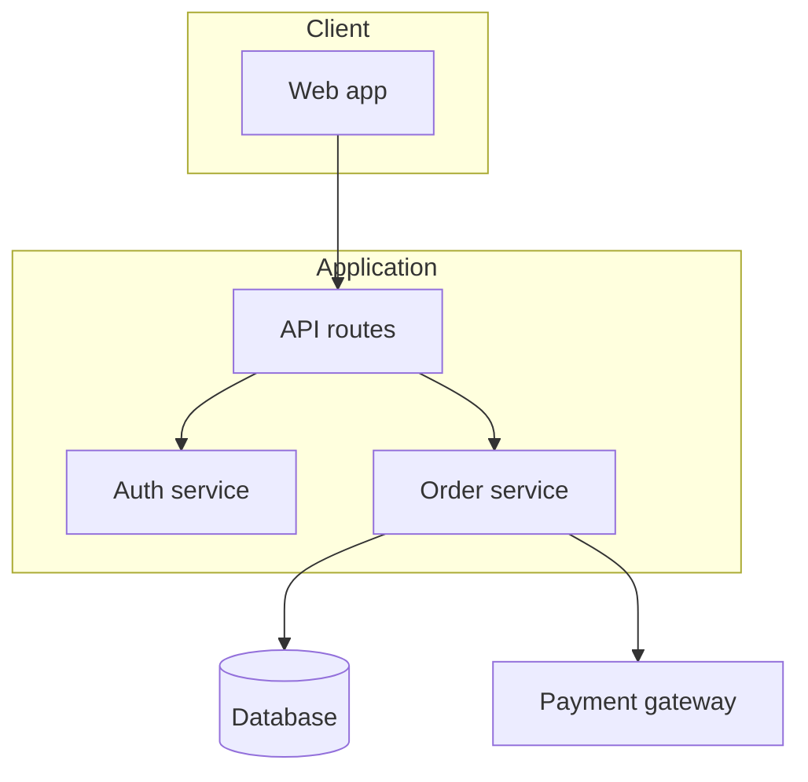

<!-- skill-readme:begin -->
# codebase-architecture-scanner

Scans codebase to generate comprehensive high-level and detailed architectural documentation

[](../../../../README.md#compatibility) [](../../../../README.md#compatibility) [](../../../../README.md#compatibility)

> **Limits.** Claude app and ChatGPT: Works on a repo archive you upload; writing the docs back into the repo is manual.

Part of the [codebase-intel](../../README.md) pack.

## When and how to use it

**Use it when:** A project has no architecture docs and a new developer starts Monday.

**Try:** `Scan this repo and write high-level and component-level architecture docs with diagrams.`

**Skip it when:** You need one function explained. Read that file instead.

## What it looks like

*Example output, invented data: one diagram from a generated `docs/architecture/overview.md`.*



```text
docs/architecture/
  overview.md         system context, stack, high-level diagram, data flow
  components.md       one section per component: purpose, key files, API, dependencies
  implementation.md   conventions, critical patterns, testing, build
  data-flow.md · integrations.md · security.md
```

## Install

<details>
<summary>Claude Code (CLI)</summary>

Add the marketplace once, then install the pack:

```bash
claude plugin marketplace add stylusnexus/agent-plugins
claude plugin install codebase-intel@stylus-nexus
```

Inside a session, `/plugin marketplace add stylusnexus/agent-plugins` and `/plugin install codebase-intel@stylus-nexus` do the same. This installs the whole codebase-intel pack, so codebase-health, grill-with-docs, read-the-damn-docs and teach-code-to-mastery come with it.

Call it as `/codebase-intel:codebase-architecture-scanner`, or let it start on its own when your request matches.

</details>

<details>
<summary>Claude Code desktop app</summary>

The desktop app's local sessions read the same plugin settings as the CLI, so a pack you installed from the terminal at user scope is already there.

To install from the app, add the marketplace once from a terminal with `claude plugin marketplace add stylusnexus/agent-plugins`. Then, in a local or SSH session on the **Code** tab, click **+** next to the prompt box, choose **Plugins**, then **Add plugin**, and pick **codebase-intel**. Plugins do not load in the app's cloud sessions.

</details>

<details>
<summary>Codex</summary>

```bash
codex plugin marketplace add stylusnexus/agent-plugins
codex plugin add codebase-intel@stylus-nexus
```

This installs the whole codebase-intel pack, so codebase-health, grill-with-docs, read-the-damn-docs and teach-code-to-mastery come with it. In Codex, type `$` and the skill name (`$codebase-intel:codebase-architecture-scanner`), or run `/skills` to pick it.

</details>

<details>
<summary>Other agents, Skills CLI</summary>

The [Skills CLI](https://github.com/vercel-labs/skills) finds the agents you have and writes the skill into each one's skills folder.

```bash
npx skills add stylusnexus/agent-plugins --skill codebase-architecture-scanner
```

Skills arrive without a pack prefix: `/codebase-architecture-scanner` in most agents and `@codebase-architecture-scanner` in Windsurf. opencode shows `/codebase-architecture-scanner` only when the skill sets an opencode-specific metadata field, and Gemini CLI starts a skill itself after you approve it.

</details>

<details>
<summary>Other agents, by folder</summary>

`.agents/skills` is read by Codex, Gemini CLI, Antigravity CLI, Cursor, GitHub Copilot, opencode and Windsurf. Claude Code reads `.claude/skills`. Cline does not read `.agents/skills`; use `.cline/skills` or `.claude/skills` there.

Copy the skill folder:

```bash
git clone --depth 1 https://github.com/stylusnexus/agent-plugins
mkdir -p .agents/skills
cp -R agent-plugins/plugins/codebase-intel/skills/codebase-architecture-scanner .agents/skills/
```

</details>

<details>
<summary>Claude app (partial)</summary>

1. Turn on **Code execution and file creation** in **Settings > Capabilities**. On Team and Enterprise plans, an owner controls this.
2. Zip the skill folder, so the ZIP holds the `codebase-architecture-scanner` folder:

   ```bash
   git clone --depth 1 https://github.com/stylusnexus/agent-plugins
   cd agent-plugins/plugins/codebase-intel/skills
   zip -r codebase-architecture-scanner.zip codebase-architecture-scanner
   ```

3. In Claude, open **Customize > Skills**, click **+**, then **+ Create skill**, choose **Upload a skill** and pick `codebase-architecture-scanner.zip`.

**Limit:** Works on a repo archive you upload; writing the docs back into the repo is manual.

</details>

<details>
<summary>ChatGPT (partial)</summary>

ChatGPT gets this skill through the Codex plugin, which brings the whole codebase-intel pack. Run the two Codex commands above, then in ChatGPT type `@` and the skill name.

**Limit:** Works on a repo archive you upload; writing the docs back into the repo is manual.

</details>
<!-- skill-readme:end -->
