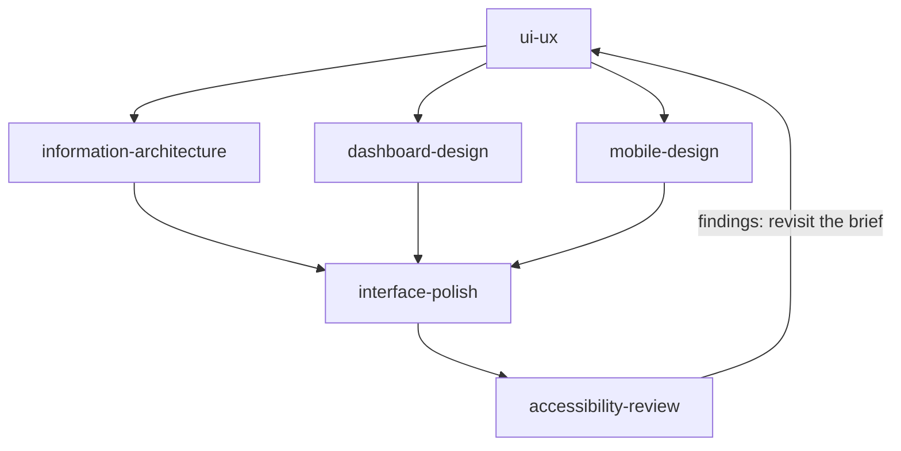

# Design Suite

A design lead plus six focused skills for UI/UX work: user flows and screen states, interface polish (spacing, type, colour, motion), art direction for websites and app screens, accessibility review against WCAG 2.2, dashboards, mobile and responsive design, and information architecture.

These are AI review perspectives. They inspect your real interface and return specific, checkable findings, but they are not user research, an accessibility audit, or a stand-in for testing with real people. Every skill labels its output as expert review and lists the checks that still need real users, a browser, or assistive technology.

---

## The skills

| Skill | Use it when |
|---|---|
| `ui-ux` | You are designing or reviewing a flow, screen, form, or state, or want a design brief or an implementation handoff. The entry point: it frames the user task, then routes to the skills below. |
| `interface-polish` | A screen works but looks uneven: spacing, radii, shadows, type, colour, dark mode, motion, or missing hover, focus, loading, empty and error states. |
| `art-direction` | A page or screen looks generic, templated or "AI-made", or you are building a landing page, portfolio, product page or app screen and want a deliberate look: it deals researched directions, enforces a no-slop house style and checks the result in a real browser. |
| `accessibility-review` | You want a keyboard, screen-reader, contrast, reflow, target-size or motion review against WCAG 2.2 AA, with prioritised findings and fixes. |
| `dashboard-design` | You are designing or fixing a dashboard, console, status view, or data-heavy screen, including stale, missing and partial data. |
| `mobile-design` | A flow must work on phones and small windows: touch targets, navigation, mobile forms, slow or offline networks, and web-versus-native questions. |
| `information-architecture` | You are organising navigation, labels, taxonomy, URLs or content types, or chasing a "people cannot find X" report. |

Eight Claude Code agents ship alongside, each a bounded role that reads the matching skill first: `ui-ux-lead` (the design lead), `design-ui-engineer` (implements an approved design), `dashboard-designer`, `accessibility-expert`, `mobile-design-expert`, `information-architect`, `ux-designer` (checks that users can find things, reviews changes for UX regressions, files issues) and `direction-reviewer` (judges a built page from screenshots and the direction sheet only; pages, not app screens). They ship as Claude Code agents in `agents/` and as Codex agents in `codex-agents/` (generated from the Claude ones, with a test that keeps them in step). The Skills CLI installs skills, not agents. Every skill works without them.

The `ux-review` skill in the [`ship-pipeline`](../ship-pipeline) pack rates screenshots against a UX checklist. This pack's skills are complementary: they work from the product, its code and your description rather than from a folder of screenshots, and `ux-review` can feed them findings to act on.

---

## Rule ownership

`ui-ux` owns the task, the flow and the order of work. Each other skill owns one concern and defers the rest.

| Skill | Owns |
|---|---|
| `ui-ux` | The user task, flow and full state set, the heuristic review, the design brief, and the handoff |
| `interface-polish` | Visual detail: spacing scale, radii, shadows, type, colour tokens, motion, and the state matrix. Report-only unless asked to implement |
| `art-direction` | The visual idea and look of a page or screen: the chosen direction, type system, palette, photographs, section blueprints, the browser inspection and look-and-fix loop, and a redesign check that the new page kept the old page's links, forms and fields, with an up-front warning on framework pages whose click handlers it cannot see |
| `accessibility-review` | WCAG 2.2 AA findings, evidence tags (verified or needs test), and the list of checks not performed. Never states that an interface is compliant |
| `dashboard-design` | Decision-first layout, freshness and provenance, data states, thresholds, and chart and number choices |
| `mobile-design` | Touch, narrow-width layout, input and keyboards, offline behaviour, and the web-versus-native question |
| `information-architecture` | Hierarchy, navigation, labels, taxonomy, URLs and the content model, with a redirect plan for any move |

Exact contrast ratios, target sizes and screen-reader behaviour belong to `accessibility-review`; `interface-polish` points there rather than restating them. Product strategy, pricing and priority stay with you.

No skill publishes, merges, deploys, or contacts users. Plans, reviews and proposals come back to you.

---

## What it looks like

<details>
<summary>Compatibility at a glance</summary>

| Skill | Claude Code | Claude app | Codex | ChatGPT | Other agents |
|---|---|---|---|---|---|
| accessibility-review | ✔ | ◐ | ✔ | ◐ | ✔ |
| art-direction | ✔ | ◐ | ✔ | ◐ | ◐ |
| dashboard-design | ✔ | ✔ | ✔ | ✔ | ✔ |
| information-architecture | ✔ | ✔ | ✔ | ✔ | ✔ |
| interface-polish | ✔ | ◐ | ✔ | ◐ | ✔ |
| mobile-design | ✔ | ✔ | ✔ | ✔ | ✔ |
| ui-ux | ✔ | ✔ | ✔ | ✔ | ✔ |

✔ full · ◐ partial · ✖ no. What each host means, and the limits behind each mark: [Compatibility](../../README.md#compatibility).

</details>

The usual order of work, starting from `ui-ux`. The task and flow come first, the specialist perspectives next, and the polish and accessibility passes once the structure holds.



Each example below is a short sample of a skill's output. They all use one invented product, **Quill**, an invoicing app for freelancers. The screens, numbers and findings are made up. No skill publishes or changes anything on its own; every sample is a draft for you to review.

<details>
<summary><code>ui-ux</code>: a design brief with findings tagged by kind</summary>

[](../../README.md#compatibility) [](../../README.md#compatibility) [](../../README.md#compatibility)

**Use it when:** You are designing or reviewing a flow, screen or state and want a brief before anyone builds.

**Try:** `Review the Quill "send invoice" flow and write a design brief.`

**Skip it when:** The question is only about one area, such as navigation labels or contrast. Use the matching skill.

Example output, invented data (fictional product). This is an expert heuristic review, not user research.

```text
BRIEF: Send invoice                       Evidence: code + 3 screenshots supplied
User and task   freelancer sends a finished invoice to a client in under a minute
Unknown         how often clients ask for a resend (MISSING INFORMATION)

Finding                                           Kind            Severity
Send button looks the same when disabled           observation     high
No state shown while the email is sending          observation     high
Users may think "Send" also marks it paid          interpretation  medium (test it)
Add a sending state and a "Sent to ana@example.com" confirmation   recommendation

Acceptance criteria
- Send is disabled with a stated reason until a client email is set
- A sending, sent and failed state each exist, and failed offers Retry
Needs real users: does "Send" read as "mark paid"? Run a five-person test.
```

</details>

<details>
<summary><code>interface-polish</code>: a before/after table by design principle</summary>

[](../../README.md#compatibility) [](../../README.md#compatibility) [](../../README.md#compatibility)

> **Limits.** Claude app and ChatGPT: Reviews code or screenshots you paste or upload; the source pass over a whole project needs the repo. The optional scan script needs a local checkout.

**Use it when:** A screen works but spacing, radii, type, colour or motion feel inconsistent.

**Try:** `Polish the Quill invoice list. Report only; do not edit files.`

**Skip it when:** You need exact contrast ratios or screen-reader behaviour (use accessibility-review), or a full redesign (use ui-ux).

Example output, invented data (fictional product). The report uses the project's own tokens, and nothing here was verified in a browser.

```text
Mode: report only          Design system used: tailwind.config.ts

Principle        Before                              After                      File
Spacing scale    gap-[13px] between rows            gap-3 (token)              InvoiceList.tsx
Transitions      transition: all 300ms              transition-colors 150ms    Row.tsx
Radius           card rounded-lg inside rounded-lg  inner rounded-md            Card.tsx

Not fixed
Severity  Finding                                           File
medium    Empty list shows a blank area, no empty state     InvoiceList.tsx

Could not verify: dark mode and 320px width (no browser available)
```

</details>

<details>
<summary><code>art-direction</code>: a chosen direction, then a look-and-fix loop on screenshots</summary>

[](../../README.md#compatibility) [](../../README.md#compatibility) [](../../README.md#compatibility)

> **Limits.** Claude app and ChatGPT: No local Node or Chrome to run the direction, inspect, redesign-check and lint scripts; the written art-direction guidance still applies to pages you describe or paste. Other agents: The scripts (the inspector and the redesign check) need Node 22+ and a local Chrome-family browser (Chrome, Edge or Chromium); without them only the written guidance applies.

**Use it when:** A landing page, portfolio, product page or app screen looks generic or "AI-made" and you want a deliberate, researched look.

**Try:** `Art-direct the Quill landing page. Deal me directions and build the one I pick.`

**Skip it when:** You need an accessibility verdict, a flow or information architecture. Use the matching skill. Use `interface-polish` for small spacing and state fixes on a look that is already decided.

Example output, invented data (fictional product). The directions and findings below are made up for the sample.

```text
Brief: Quill, invoicing for freelancers      Idea: "paid on time, quietly"
Dealt   1 Ledger paper (warm, serif)   2 Field notes (grid, mono accents)   3 Plain speech (large type, one colour)
Chosen  1 Ledger paper    Type: serif display + grotesque body    Palette: cream, ink, one green
Built   hero, how it works, pricing, FAQ     Section blueprints applied: 4
Inspect (real browser, 390 and 1440 px)
  hero headline overflows at 390 px             fixed: clamp() on the display size
  three equal icon cards under the hero         fixed: replaced by one worked example
  placeholder photo copy ("Lorem")              open: needs a real photograph
Lint: 0 slop patterns remaining
```

</details>

<details>
<summary><code>accessibility-review</code>: prioritised findings with fixes and checks not performed</summary>

[](../../README.md#compatibility) [](../../README.md#compatibility) [](../../README.md#compatibility)

> **Limits.** Claude app and ChatGPT: Reviews code or screenshots you paste or upload; the source pass over a whole project needs the repo. The optional contrast script takes colours you type in.

**Use it when:** You want a WCAG 2.2 AA review of keyboard, focus, names, contrast, forms or motion.

**Try:** `Review the Quill invoice form for accessibility.`

**Skip it when:** You want a compliance statement, a VPAT, or caption review. None of those can come from this skill.

Example output, invented data (fictional product). Each finding is tagged VERIFIED (seen in source) or NEEDS-TEST (needs a browser or assistive technology).

```text
A1  Serious  WCAG 3.3.1 (A)   InvoiceForm.tsx:84
Observed    <input> for "Client email" has only a placeholder; error shown in red text
Affects     screen-reader users: the field has no accessible name, the error is not announced
Fix         <label htmlFor="email">Client email</label> and aria-describedby="email-error"
Evidence    VERIFIED (source)

A2  Moderate  WCAG 1.4.3 (AA)  tokens.css:12
Observed    #8a8a8a text on #ffffff measures 3.45:1 (needs 4.5:1)
Fix         use #767676 (4.54:1) or darker
Evidence    VERIFIED (computed)

Checks not performed: keyboard walk-through, 200% zoom, VoiceOver (no browser or device)
Summary     2 findings in the source pass. This is not a conformance statement.
```

</details>

<details>
<summary><code>dashboard-design</code>: layout by decision, with a state table</summary>

[](../../README.md#compatibility) [](../../README.md#compatibility) [](../../README.md#compatibility)

**Use it when:** A dashboard is noisy, looks healthy when it should not, or is being designed from scratch.

**Try:** `Design the Quill revenue overview for a freelancer who checks it each Monday.`

**Skip it when:** You only need a chart type for one number. Ask directly.

Example output, invented data (fictional product). Thresholds are labelled recommended and need owner confirmation.

```text
User and decision   freelancer, weekly: "who do I chase this week?"   (cadence: assumption)
Layout by priority  1 overdue invoices (count, total, oldest)   2 due this week   3 paid this month

Signal             Source             Freshness     States designed
Overdue total      invoices table     live          loading, empty ("nothing overdue"), error
Bank sync          bank provider      checked 09:12 stale after 24 h (recommended), unavailable
"All clear" shows only when the bank sync is fresh. Otherwise: "Bank not checked since 09:12".
Open question   which overdue age should turn red? (owner decision)
```

</details>

<details>
<summary><code>mobile-design</code>: per-screen rules checked at a stated viewport</summary>

[](../../README.md#compatibility) [](../../README.md#compatibility) [](../../README.md#compatibility)

**Use it when:** A flow must work on phones, or a desktop layout needs to adapt to narrow widths.

**Try:** `Adapt the Quill invoice list and send flow for phones.`

**Skip it when:** The question is about desktop-only layout, or you want a native app built.

Example output, invented data (fictional product). Device mix and connectivity are unknown, so they are marked.

```text
Screen: Invoice list         Device mix: MISSING INFORMATION
Priority    1 status + amount   2 client   3 due date   (actions in a row menu)
Layout      narrow: single column cards   medium: two-line rows   wide: table
Controls    Send button 48 px high (recommended); row menu target 44 x 44 px
Navigation  bottom bar with 3 items; back returns to the list with filters kept
States      empty, loading, offline ("Will send when you are back online"), error
Input       client email field: type=email, autocomplete=email
Accept      at 320 CSS px wide and 200% text size, nothing scrolls sideways
Web or native   responsive web is enough for this flow (product owners decide)
```

</details>

<details>
<summary><code>information-architecture</code>: a hierarchy, label table and task paths</summary>

[](../../README.md#compatibility) [](../../README.md#compatibility) [](../../README.md#compatibility)

**Use it when:** Navigation, labels or URLs are being reorganised, or people cannot find something.

**Try:** `Reorganise the Quill settings menu; people cannot find tax settings.`

**Skip it when:** You want visual styling for the menu. Use interface-polish.

Example output, invented data (fictional product). The walkthrough is expert review, not a tree-test result.

```text
Settings
  Account         profile, password, email
  Billing         plan, payment method
  Invoicing       numbering, due dates, tax rates   <- moved from "Advanced"
  Integrations    bank sync, calendar

Current label  Proposed label   Reason
Advanced       Invoicing        "Advanced" says nothing; tax and numbering live here
Task path      "Add VAT rate": Settings > Invoicing > Tax rates (3 steps)
Redirect       /settings/advanced -> /settings/invoicing (proposal, not applied)
Needs real users: a 5-participant tree test of the new labels. Results: MISSING INFORMATION.
```

</details>

---

## Install

### Claude Code

```
/plugin marketplace add stylusnexus/agent-plugins
/plugin install design-suite@stylus-nexus
```

Skills are namespaced: `/design-suite:ui-ux`. The eight agents install with the plugin.

### Codex

```
codex plugin marketplace add stylusnexus/agent-plugins
codex plugin add design-suite@stylus-nexus
```

In Codex, type `$` and a skill name to use it (`$design-suite:ui-ux`; Codex prefixes plugin skills with the pack name), or run `/skills` to pick one.

The Codex agents are separate files, not part of the plugin install. Copy them once:

```
git clone --depth 1 https://github.com/stylusnexus/agent-plugins
mkdir -p ~/.codex/agents
cp agent-plugins/plugins/design-suite/codex-agents/*.toml ~/.codex/agents/
```

Start a new Codex session afterwards. Each agent reads the matching skill first, so install the plugin too.

Codex agent files have no tool list, so the ux-designer's no-edit rule, and the direction-reviewer's read-only rule and its rule to read only the files it is handed, are only written instructions on Codex. Run them in a read-only sandbox (`codex exec -s read-only` or `codex --sandbox read-only`). If the sandbox stops the ux-designer reaching the issue tracker, it lists what it could not do.

### Everything else — Cursor, Copilot, Gemini CLI, Windsurf, Zed, opencode, Cline, Continue, Hermes, and ~60 more

```bash
npx skills add stylusnexus/agent-plugins --skill accessibility-review art-direction dashboard-design information-architecture interface-polish mobile-design ui-ux
```

Skills arrive un-namespaced on this path, so most agents invoke them as `/ui-ux`; Windsurf uses `@ui-ux`, opencode shows `/ui-ux` only when the skill sets an opencode-specific metadata field, and Gemini CLI activates a skill itself after you approve it.

## Prerequisites

None for most of the skills. `art-direction` is the exception: its draw, inspect, redesign-check and lint tools need Node 22+, and the inspector and the redesign check need a locally installed Chrome, Edge or Chromium. Network access is needed only for the optional `assets.mjs` picture search. Python 3 is needed only for the two optional scripts: `accessibility-review/scripts/contrast.py` (WCAG contrast ratios) and `interface-polish/scripts/polish_scan.py` (a read-only scan of source files for checkable polish rules). Both use only the standard library and change no files. A browser and assistive technology are needed for the checks the skills list as "needs test"; the skills never claim those were done.

`art-direction` is a fork of [Leonxlnx's taste-skill](https://github.com/Leonxlnx/taste-skill) (MIT); see its `PROVENANCE.md` for what changed. Its draw and inspect tools write working files into a `.taste-skill/` folder in your project, and a history file under your home folder; set `TASTE_SKILL_HISTORY` to put the history file somewhere else.
