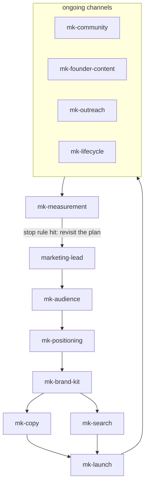

# Go-to-Market

A head of marketing and eleven focused skills for small teams and solo builders. Plans start from a goal and the hours you actually have, favour honest persuasion over tricks, keep evidence and assumptions separate, and explain the marketing reasoning as they go.

---

## The skills

| Skill | Use it when |
|---|---|
| `marketing-lead` | You want a marketing plan, or don't know why nobody is using the product. Routes to the skills below and teaches as it goes. |
| `mk-positioning` | Working out who the product is for, what it beats, and how to say it in one line. Built on April Dunford's positioning method. |
| `mk-audience` | Choosing the first customer, writing an ideal customer profile, and finding who influences the buyer. |
| `mk-copy` | Writing or editing a landing page, README opening, store listing, or announcement. |
| `mk-brand-kit` | Settling a product's voice, palette, fonts, and logo use, and picking a design tool. |
| `mk-search` | Getting found in search and cited by AI assistants: citable pages, `llms.txt`, test-question panels. |
| `mk-launch` | Planning a launch or relaunch: Show HN, Product Hunt, release-day posts, and the readout afterwards. |
| `mk-community` | Taking part in Discord servers, subreddits, forums, and open-source communities without spamming them. |
| `mk-founder-content` | Founder posts, building in public, newsletters, and finding the stories worth telling. |
| `mk-outreach` | Cold email, press and podcast pitches, design partners, and warm introductions. |
| `mk-lifecycle` | Waitlist, onboarding, activation, upgrade, and win-back email sequences. |
| `mk-measurement` | Choosing what to measure, reading whether a channel worked, and running trustworthy experiments. |

Two Claude Code agents ship alongside: `marketing-lead` (the same head of marketing, in its own context) and `audience-scout`, which finds the real online places an audience gathers and verifies each by fetching the page. It only reads; it never posts, joins, or messages.

---

## Rule ownership

`marketing-lead` owns the plan and the order of work; each `mk-*` skill owns one kind of output. Positioning comes before copy: `mk-copy` asks for a settled position from `mk-positioning` rather than inventing one. Product strategy is out of scope; when there is no clear customer or promise yet, the skills point to the [`product-strategy`](../product-strategy) plugin (`product-manager`, `pm-value-proposition`).

No skill posts, sends, or publishes anything on your behalf. Plans and drafts come back to you.

---

## What it looks like

<details>
<summary>Compatibility at a glance</summary>

| Skill | Claude Code | Claude app | Codex | ChatGPT | Other agents |
|---|---|---|---|---|---|
| marketing-lead | ✔ | ✔ | ✔ | ✔ | ✔ |
| mk-audience | ✔ | ◐ | ◐ | ◐ | ◐ |
| mk-brand-kit | ✔ | ✔ | ✔ | ✔ | ✔ |
| mk-community | ✔ | ✔ | ✔ | ✔ | ✔ |
| mk-copy | ✔ | ◐ | ✔ | ✔ | ✔ |
| mk-founder-content | ✔ | ◐ | ✔ | ✔ | ✔ |
| mk-launch | ✔ | ◐ | ✔ | ✔ | ✔ |
| mk-lifecycle | ✔ | ◐ | ✔ | ✔ | ✔ |
| mk-measurement | ✔ | ✔ | ✔ | ✔ | ✔ |
| mk-outreach | ✔ | ◐ | ✔ | ✔ | ✔ |
| mk-positioning | ✔ | ✔ | ✔ | ✔ | ✔ |
| mk-search | ✔ | ◐ | ✔ | ✔ | ✔ |

✔ full · ◐ partial · ✖ no. What each host means, and the limits behind each mark: [Compatibility](../../README.md#compatibility).

</details>

The usual order of work, starting from `marketing-lead`. Who the product is for comes first. Positioning comes before the brand and the words. The launch comes before the ongoing channels, and measurement decides whether a channel keeps its hours.



Each example below is a short sample of a skill's output. They all use one invented product, **Plant Ledger**, a watering tracker for people with large houseplant collections. The people, communities, numbers, and quotes are made up. No skill posts, sends, or publishes anything; every sample is a draft for you to review.

<details>
<summary><code>marketing-lead</code>: a goal-first plan sized to your hours</summary>

[](../../README.md#compatibility) [](../../README.md#compatibility) [](../../README.md#compatibility)

Example output, invented data (fictional product).

```text
PLAN: next 6 weeks                         Hours available: 4 a week
Goal         200 collectors on the waitlist by week 6 (now: 35)
Who acts     collectors with 20+ plants who lose plants while traveling
What moves   seeing their own rooms on a schedule in under 2 minutes
Channels     1. one collector forum, 2 h/week   stop if under 10 sign-ups by week 3
             2. founder posts, 1 h/week         stop if under 5 sign-ups by week 4
             3. waitlist email, 1 h/week        check replies, not opens
Not doing    paid ads (no budget), press (nothing to show yet)
Decided      collectors first; casual owners later
Open         does "travel mode" matter more than room setup? (assumption)
Next action  today: write the forum intro post as a draft for your review
```

</details>

<details>
<summary><code>mk-audience</code>: an ideal customer profile from evidence</summary>

[](../../README.md#compatibility) [](../../README.md#compatibility) [](../../README.md#compatibility)

> **Limits.** Claude app and ChatGPT: No audience-scout agent, so the verified-places step must be done inline with web search. Codex: Codex plugins do not carry agents, so audience-scout is missing and the verified-places step has no stated fallback. Other agents: The Skills CLI installs skills only, so audience-scout is missing and the verified-places step has no stated fallback.

Example output, invented data (fictional product). Any field without a real source is marked, not filled with a guess.

```text
IDEAL CUSTOMER PROFILE                      Source
Who            hobby collector, 20+ indoor plants      14 beta sign-up forms
Already uses   phone calendar, a spreadsheet           6 interviews
Tried, quit    2 plant apps ("too many ads")           forum thread, 2026-08
Job (practical) keep every plant watered on time        interviews
Job (emotional) stop feeling guilty after a trip        3 interview quotes
Trigger        loses a plant after a holiday           MISSING INFORMATION
Disqualifier   owns fewer than 10 plants               ASSUMPTION
Segments       one for now; the evidence does not support a split by region
Buying roles   initiator and user are the same person; partner may share the app
```

</details>

<details>
<summary><code>mk-positioning</code>: the positioning canvas and a one-liner</summary>

[](../../README.md#compatibility) [](../../README.md#compatibility) [](../../README.md#compatibility)

Example output, invented data (fictional product).

```text
1 Competitive alternative   a phone calendar with repeating reminders
2 Differentiated capability schedules per room that shift with season and travel
3 Value                     no plant lost to a reminder that fired on the wrong day
4 Target segment            collectors with 20+ plants in several rooms
5 Market category           watering tracker for collectors (not "plant care app")
Rejected                    "plant care app": puts us against plant-ID apps we don't beat
One-liner   Plant Ledger keeps a 40-plant collection on schedule, room by room,
            even when you travel.
Stakeholder check
  Customer   true and useful: yes        Business   supports a paid tier: unknown
  Community  names no competitor: yes
```

</details>

<details>
<summary><code>mk-brand-kit</code>: a brand kit canvas with measured contrast</summary>

[](../../README.md#compatibility) [](../../README.md#compatibility) [](../../README.md#compatibility)

Example output, invented data (fictional product). Colors are exact values, and each pairing has a measured WCAG contrast ratio.

| Role | Hex | Paired against | Contrast | Passes? |
|---|---|---|---|---|
| Body text | #1F2A24 | background #F7F5EF | 13.61:1 | yes (4.5:1 normal text) |
| Accent text, links | #2E6B4F | background #F7F5EF | 5.78:1 | yes |
| Button label | #FFFFFF | button #2E6B4F | 6.30:1 | yes |
| Decorative leaf | #8FBF9F | background #F7F5EF | 1.90:1 | no: never use it for text |

Type roles: heading and body only, from one font family. The product voice sheet is marked HUMAN DECISION REQUIRED until the owner approves it.

</details>

<details>
<summary><code>mk-copy</code>: a landing-page draft with a claim-to-source table</summary>

[](../../README.md#compatibility) [](../../README.md#compatibility) [](../../README.md#compatibility)

> **Limits.** Claude app: Each upload is one skill folder, so the shared-principles file this skill reads from a sibling skill is missing unless you bundle it in.

Example output, invented data (fictional product). Anything without a source stays a visible gap.

```text
Headline     Water 40 plants without a spreadsheet
Hook         Schedules per room that move when you travel
Objection    "I already use calendar reminders"
Answer       Calendars repeat dates. Plants need a schedule that shifts with season.
Proof        MISSING INFORMATION: no user result we can cite yet

Claim                                   Source
Schedules per room                      shipped feature, release notes v0.4
Travel mode pauses and catches up       shipped feature, release notes v0.5
"Collectors stopped losing plants"      MISSING INFORMATION: not stated
Persuasion levers used   none. Social proof is left out until a real result exists.
```

</details>

<details>
<summary><code>mk-search</code>: an AI test-question panel log</summary>

[](../../README.md#compatibility) [](../../README.md#compatibility) [](../../README.md#compatibility)

> **Limits.** Claude app: Each upload is one skill folder, so the shared-principles file this skill reads from a sibling skill is missing unless you bundle it in.

Example output, invented data (fictional product). Questions come from real conversations; one "not cited" result means check again, not give up.

| Date | Assistant | Question | Mentioned? | Cited or described? | Position | Others named |
|---|---|---|---|---|---|---|
| 2026-09-01 | assistant A | how do I track watering for 40 plants | no | n/a | absent | two plant apps, both linked |
| 2026-09-01 | assistant B | watering schedule app for plant collectors | yes | described, no link | mid-answer | one plant app |
| 2026-09-15 | assistant A | how do I track watering for 40 plants | yes | cited, linked | first | none |

Quotable answer on the page: "Plant Ledger builds a separate watering schedule for each room and shifts it when you travel."

</details>

<details>
<summary><code>mk-launch</code>: a launch-day checklist</summary>

[](../../README.md#compatibility) [](../../README.md#compatibility) [](../../README.md#compatibility)

> **Limits.** Claude app: Each upload is one skill folder, so the shared-principles file this skill reads from a sibling skill is missing unless you bundle it in.

Example output, invented data (fictional product).

```text
LAUNCH DAY: Show HN, Thursday
Before the post goes up
  [x] Touchpoint audit: landing page, onboarding, empty states, signup email ready
  [ ] Pricing page: known gap, owner: founder, note posted on the page
  [x] Show HN rules re-fetched today, not reused from last time
  [x] Post copy checked in mk-copy; no asks for upvotes anywhere
  [x] The thing being shown works for a stranger right now
During launch
  [ ] Comments checked every 20 minutes for the first 4 hours
  [ ] Bugs logged in the issue tracker, triaged live by the second founder
End of day
  [ ] Numbers captured for the post-launch readout today, not next week
```

</details>

<details>
<summary><code>mk-community</code>: a participation log with the rules checked first</summary>

[](../../README.md#compatibility) [](../../README.md#compatibility) [](../../README.md#compatibility)

Example output, invented data (fictional community). The rules page is fetched and dated before any post is drafted.

| Date | Community | Give | Ask | Response | Give:ask |
|---|---|---|---|---|---|
| 2026-09-02 | r/ExampleHouseplants (fictional) | rules fetched; answered 3 watering questions | none | 2 thanks, 1 follow-up | 3:0 |
| 2026-09-09 | r/ExampleHouseplants | shared a free watering-log template | none | 40 upvotes, 6 saves | 4:0 |
| 2026-09-16 | r/ExampleHouseplants | answered 2 questions | posted a build update in the weekly self-promo thread, per rule 4 | 5 comments, no complaints | 6:1 |

</details>

<details>
<summary><code>mk-founder-content</code>: a week of posts cut from one source piece</summary>

[](../../README.md#compatibility) [](../../README.md#compatibility) [](../../README.md#compatibility)

> **Limits.** Claude app: Each upload is one skill folder, so the shared-principles file this skill reads from a sibling skill is missing unless you bundle it in.

Example output, invented data (fictional product). One substantial piece, then short posts cut from it. Nothing is scheduled until the owner approves.

| Angle | Platform | One-line point | Real fact used | Status |
|---|---|---|---|---|
| The finding | LinkedIn | collectors lose plants after trips, not on normal weeks | 6 of 6 interviews (invented) | drafted |
| The how | Bluesky | build the schedule per room, not per plant | release notes v0.4 | drafted |
| The proof | LinkedIn | MISSING INFORMATION: needs a beta result from owner | none yet | blocked |
| The question | Bluesky | how do you handle watering when you travel? | n/a | not started |

Hours this week: 2. Stop rule: if waitlist sign-ups from posts don't move after 4 weeks, post less often and change the topic.

</details>

<details>
<summary><code>mk-outreach</code>: a tracked, one-to-one design-partner ask</summary>

[](../../README.md#compatibility) [](../../README.md#compatibility) [](../../README.md#compatibility)

> **Limits.** Claude app: Each upload is one skill folder, so the shared-principles file this skill reads from a sibling skill is missing unless you bundle it in.

Example output, invented data (fictional people and shop).

```text
Recipient     Rosa Lind, owner, Fern & Frond (fictional plant shop)
Path          warm, via a shared forum moderator, who agreed first
Verified fact her shop runs a monthly "plant sitting" service (shop website)
Ask           try Plant Ledger for the plant-sitting rota; I set it up by hand
Legal floor   not needed: this is a warm introduction, not a cold message
Status        drafted, awaiting your approval. Not sent.

TRACKER
Date        Recipient   Path   Channel  Fact used        Approved  Response
2026-09-04  R. Lind     warm   email    plant sitting    yes       interested
2026-09-11  T. Moss     cold   email    posted a guide   yes       no reply
Reply-rate assumption: 1 in 10 (ASSUMPTION until the first batch of 20)
```

</details>

<details>
<summary><code>mk-lifecycle</code>: a lifecycle map and a behaviour-triggered sequence</summary>

[](../../README.md#compatibility) [](../../README.md#compatibility) [](../../README.md#compatibility)

> **Limits.** Claude app: Each upload is one skill folder, so the shared-principles file this skill reads from a sibling skill is missing unless you bundle it in.

Example output, invented data (fictional product). Emails fire on what someone did, not on a fixed day count.

| Stage | What moves someone in | Recorded in | Next-stage trigger |
|---|---|---|---|
| Waitlist | joined the waitlist | email tool | invite accepted |
| Signed up | account created | product database | adds a second room |
| Activated | 2+ rooms set up | product database | waters on schedule in week 2 |

| # | Trigger | Goal | The one ask |
|---|---|---|---|
| 1 | signed up | set expectations | add your first room |
| 2 | no second room after 3 days | remove the blocker | add one more room |
| 3 | second room added | point at the next win | turn on travel mode |

Results are read from clicks, replies, and unsubscribes. Open rate is context only.

</details>

<details>
<summary><code>mk-measurement</code>: a scorecard and an experiment card</summary>

[](../../README.md#compatibility) [](../../README.md#compatibility) [](../../README.md#compatibility)

Example output, invented data (fictional product). Every metric sits on one funnel stage and has a formula you can recompute by hand.

| Stage | Metric | Formula | Source | Something's-wrong trigger | This period |
|---|---|---|---|---|---|
| Acquisition | waitlist sign-ups by channel | new sign-ups grouped by source tag | email tool | any channel drops 30% week on week | 118 |
| Activation | second-room rate | users with 2+ rooms ÷ sign-ups, 3-day window | product database | below 40% | 45% |
| Revenue | trial-to-paid | not yet applicable: pre-launch | none | none | none |

```text
EXPERIMENT CARD   Guided room setup vs. current setup
Primary metric    second-room rate     Sample size fixed in advance: 400 per arm
Decision rule     ship if +8 points or more; otherwise keep current setup
Checks            no early peeking; traffic split matches the 50/50 setting
```

</details>

---

## Install

### Claude Code

```
/plugin marketplace add stylusnexus/agent-plugins
/plugin install go-to-market@stylus-nexus
```

Skills are namespaced: `/go-to-market:marketing-lead`.

### Codex

```
codex plugin marketplace add stylusnexus/agent-plugins
codex plugin add go-to-market@stylus-nexus
```

In Codex, type `$` and a skill name to use it (`$go-to-market:marketing-lead`; Codex prefixes plugin skills with the pack name), or run `/skills` to pick one.

### Everything else — Cursor, Copilot, Gemini CLI, Windsurf, Zed, opencode, Cline, Continue, Hermes, and ~60 more

```bash
npx skills add stylusnexus/agent-plugins --skill marketing-lead mk-audience mk-brand-kit mk-community mk-copy mk-founder-content mk-launch mk-lifecycle mk-measurement mk-outreach mk-positioning mk-search
```

Skills arrive un-namespaced on this path, so most agents invoke them as `/marketing-lead`; Windsurf uses `@marketing-lead`, opencode shows `/marketing-lead` only when the skill sets an opencode-specific metadata field, and Gemini CLI activates a skill itself after you approve it.

## Prerequisites

None. `audience-scout` uses web search and fetch where the host provides them.

## Sources

Methods are credited to their originators where one exists; books appear only as further reading. See the [source list](skills/marketing-lead/references/sources.md).
