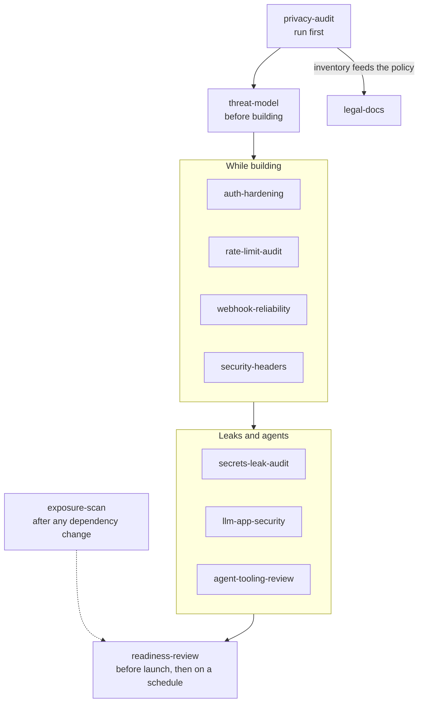

# Hardening

Twelve skills: eleven security checks (six pre-launch gates for the unglamorous failures that ship to production constantly, plus five that cover design time and the agent era) and `legal-docs` for the customer-facing legal documents a launch needs.

None of this is exotic. A missing rate limit on an endpoint that calls a paid API, a webhook with no signature check, a compromised transitive dependency, an API key that turns up in a log line. These are cheap to check and expensive to discover in the wild.

---

## The skills

| Skill | Use it when |
|---|---|
| `rate-limit-audit` | Before launch, or after adding an endpoint that calls a paid API (LLM, email, SMS) or handles auth. Inventories every such endpoint and checks each actually has a limit. |
| `exposure-scan` | Periodically, and after any dependency change. Checks installed packages across npm, Go, PyPI, RubyGems, and MCP servers against threat-intelligence catalogs for known-compromised releases. |
| `auth-hardening` | Auth is in place and needs auditing — session and cookie configuration, CSRF, OAuth scopes, per-route protection. |
| `webhook-reliability` | Designing or reviewing webhooks in either direction: signature verification, idempotency, retry and backoff, dead letters, monitoring. |
| `privacy-audit` | User data is collected and someone needs to say exactly what and where. Produces the inventory and checks it against the code and infra — not against what the privacy policy claims. |
| `readiness-review` | Before launch, or on a recurring schedule, to answer "is the code healthy and can a user actually do the core jobs?" in one report. Read-only: scans, a reviewer pass over a secret-free copy, a look-only walk of the live product, and a findings list you file yourself. |
| `threat-model` | A feature is being designed and nobody has written down who could abuse it. Produces the boundary-and-threat table before code, and names which other skill verifies each control. |
| `security-headers` | Before launch, or after a proxy or domain change. Captures the deployed response, assigns one owning layer per header, and rolls out CSP report-only first. |
| `secrets-leak-audit` | Before launch, or after a key shows up somewhere it should not. Checks git history, the production bundle, logs and error reports, and API responses. |
| `agent-tooling-review` | An MCP server, plugin, or token is being connected to an agent, or an agent will run unattended. Applies least privilege and a human gate on irreversible actions. |
| `llm-app-security` | A feature sends untrusted content to a model or lets a model act. Maps input-to-sink paths, requires gates on output and actions, and proves them with a public adversarial corpus. |
| `legal-docs` | Drafting or reviewing Terms of Service, a Privacy Policy, a refund policy, or an acceptable use policy. Checks every claim against what the product actually does and marks every draft as not legal advice, for a lawyer to review. |

---

## Rule ownership

| Skill | Owns |
|---|---|
| `rate-limit-audit` | Abuse and cost ceilings on endpoints |
| `exposure-scan` | Supply chain — what you installed and whether it's known-compromised |
| `auth-hardening` | Identity, sessions, and per-route access control |
| `webhook-reliability` | Trust and delivery guarantees at system boundaries |
| `privacy-audit` | What data exists, where it lands, and who can reach it |
| `readiness-review` | The overall launch verdict: code health, live database structure, and whether a user can do the core jobs |
| `threat-model` | Deciding what to defend and which gate checks it |
| `security-headers` | Browser-enforced controls on the deployed response |
| `secrets-leak-audit` | Credentials and personal data leaving through git, bundles, logs, responses |
| `agent-tooling-review` | What an agent is permitted to connect to and do, attended or not |
| `llm-app-security` | What untrusted content can make a model do |
| `legal-docs` | What the customer-facing legal documents say, and that each claim matches the product |

Two of these are about **cost and abuse** (`rate-limit-audit`, `exposure-scan`), two about **trust boundaries** (`auth-hardening`, `webhook-reliability`), one about **data itself** (`privacy-audit`), and one steps back to ask whether the whole thing is ready (`readiness-review`). `threat-model` runs first and decides which of the others a feature needs; its table names the skill that verifies each control. They compose but don't overlap: a rate-limited endpoint can still leak PII, and a correctly-scoped OAuth flow says nothing about whether your dependencies are clean.

`legal-docs` writes the documents; `privacy-audit` checks the practices they describe. A privacy policy is drafted from the `privacy-audit` inventory, never the other way round.

The one worth running first is `privacy-audit`, because it's the only one whose finding might be *"we shouldn't be collecting this at all"* — and that answer changes what the others need to protect. `readiness-review` is the one to run last and then on a schedule: its report points at which of the others a finding belongs to.

---

## What it looks like

<details>
<summary>Compatibility at a glance</summary>

| Skill | Claude Code | Claude app | Codex | ChatGPT | Other agents |
|---|---|---|---|---|---|
| agent-tooling-review | ✔ | ◐ | ✔ | ◐ | ✔ |
| auth-hardening | ✔ | ◐ | ✔ | ◐ | ✔ |
| exposure-scan | ✔ | ✖ | ✔ | ✖ | ✔ |
| legal-docs | ✔ | ◐ | ✔ | ◐ | ✔ |
| llm-app-security | ✔ | ◐ | ✔ | ◐ | ✔ |
| privacy-audit | ✔ | ◐ | ✔ | ◐ | ✔ |
| rate-limit-audit | ✔ | ✖ | ✔ | ✖ | ✔ |
| readiness-review | ✔ | ✖ | ✔ | ✖ | ✔ |
| secrets-leak-audit | ✔ | ✖ | ✔ | ✖ | ✔ |
| security-headers | ✔ | ◐ | ✔ | ◐ | ✔ |
| threat-model | ✔ | ◐ | ✔ | ◐ | ✔ |
| webhook-reliability | ✔ | ◐ | ✔ | ◐ | ✔ |

✔ full · ◐ partial · ✖ no. What each host means, and the limits behind each mark: [Compatibility](../../README.md#compatibility).

</details>

When to reach for which skill, from design to launch:



Each check reports in its own words, and none of them counts a check that did not run as a pass:

| Skill | Status words | What never counts as a pass |
|---|---|---|
| `threat-model` | OPEN-BLOCKS · OPEN · MITIGATED · ACCEPTED | A blocking threat accepted by the person writing the model |
| `security-headers` | PASS · FAIL · UNVERIFIED · CONDITIONAL (CSP still report-only) | A header read from config with no live capture |
| `secrets-leak-audit` | LEAK · CLEAN · UNVERIFIED | A door that could not be checked |
| `llm-app-security` | PASS · FAIL · UNVERIFIED | A control described but not exercised by the corpus |
| `agent-tooling-review` | keep · narrow · disconnect (UNVERIFIED stays disconnected) | A connection whose source could not be checked |
| `readiness-review` | ready · at risk · not ready | A source marked NOT VERIFIED |

Each skill below has one collapsed example. All data in them is invented.

<details>
<summary><b>threat-model</b> · boundary-and-threat table with a gate list</summary>

[](../../README.md#compatibility) [](../../README.md#compatibility) [](../../README.md#compatibility)

> **Limits.** Claude app and ChatGPT: Builds the threat table from spec text; no search of the code for boundaries and no write-back to the repo.

*Example output, invented data.*

```text
Scope: public share links for invoices. Assets: invoice data, customer emails,
the email-sending bill. Actors: anonymous visitor, signed-in user, other tenant.

| # | Boundary          | Actor        | Threat (STRIDE)          | Lk   | Im   | Control                   | Verified by         | Status      |
| 1 | B1 browser -> API | anonymous    | I: guesses share link ID | med  | high | 128-bit random token      | auth-hardening      | OPEN        |
| 2 | B1 browser -> API | other tenant | E: reads other team data | med  | high | undecided: login needed?  | auth-hardening      | OPEN-BLOCKS |
| 3 | B2 API -> email   | signed-in    | D: resend loop, big bill | high | med  | 5 per hour per sender     | rate-limit-audit    | OPEN        |
| 4 | B3 payment hook   | anyone       | S: forged "paid" event   | low  | high | signature + idempotency   | webhook-reliability | MITIGATED   |

B1: S none · T none · R none · I #1 · D none · E #2
B2: S none · T none · R none · I none · D #3 · E none

Gate list: auth-hardening (B1, blocking) -> rate-limit-audit (B2) -> webhook-reliability (B3)
Record: 2026-01-12, example-agent (model name), B1-B3, accepted risks: none
```

</details>

<details>
<summary><b>auth-hardening</b> · per-route audit table</summary>

[](../../README.md#compatibility) [](../../README.md#compatibility) [](../../README.md#compatibility)

> **Limits.** Claude app and ChatGPT: Design guidance works; the audit half searches your routes and needs the repo.

*Example output, invented data.*

```text
| Route                              | Session check | Ownership/role check | Rate limit |
| GET    /api/projects/[id]          | Y             | Y                    | n/a        |
| DELETE /api/projects/[id]          | Y             | N   <- high priority | n/a        |
| server action updateSettings       | Y             | Y                    | n/a        |
| POST   /api/auth/reset-password    | n/a           | n/a                  | N          |

High: DELETE /api/projects/[id] checks that a session exists, never that the
caller owns the project. Fix: load the project, compare ownerId, return 404
(not 403) so the caller cannot learn the ID is real.
Reset password: limit by IP and by target email, same response either way.
```

</details>

<details>
<summary><b>rate-limit-audit</b> · inventory plus burst-test evidence</summary>

[](../../README.md#compatibility) [](../../README.md#compatibility) [](../../README.md#compatibility)

> **Limits.** Claude app: Runs in a remote sandbox without your local repo, git remotes or credentials. ChatGPT: No access to your local repo or git and gh credentials by default.

*Example output, invented data.*

```text
| Route or action          | Class | Limiter                       | Tested |
| POST /api/chat           | LLM   | found: 20 / 10 min, user id   | yes    |
| POST /api/auth/login     | auth  | found: 5 / 15 min, IP + email | yes    |
| action sendInvite        | email | none   <- blocks launch       | no     |

Burst test, POST /api/chat (limit 20 / 10 min)
  sequential:      20 200
                    5 429
  concurrent:      23 200
                    2 429
  rerun inside one window: 23 x 200 again -> check and increment are not
  atomic; limiter broken under concurrency. Fix before marking passed.
```

</details>

<details>
<summary><b>webhook-reliability</b> · present-or-missing report per handler</summary>

[](../../README.md#compatibility) [](../../README.md#compatibility) [](../../README.md#compatibility)

> **Limits.** Claude app and ChatGPT: Design is text; auditing an existing handler needs the code pasted in.

*Example output, invented data.*

```text
Inbound: POST /api/webhooks/payments (provider retries for 3 days)
  Signature checked before parsing    present   raw body, constant-time compare, length check
  Idempotency on provider event id    present   unique (provider, externalId), same transaction
  Fast ack, slow work queued          present
  Non-2xx when recording fails        MISSING   catch block logs and returns 200
  Dead-letter table                   present
  Dead-letter table monitored         MISSING   no alert on new rows: false confidence
  Duplicate delivery skipped          shown     test replays event 4821 -> "Already processed"

Inbound: POST /api/webhooks/repo-events (provider does not auto-retry)
  Scheduled redelivery of failures    MISSING
```

</details>

<details>
<summary><b>security-headers</b> · deployed-header check with one owner per header</summary>

[](../../README.md#compatibility) [](../../README.md#compatibility) [](../../README.md#compatibility)

> **Limits.** Claude app and ChatGPT: Grades pasted header output or uploaded config; cannot capture the deployed response itself.

*Example output, invented data.*

```text
Captured on staging (deployed): page /pricing, API /api/me, asset /static/app.js

| Header                    | Current value                       | Owner         | Status      |
| Strict-Transport-Security | max-age=31536000; includeSubDomains | framework cfg | PASS        |
| Content-Security-Policy   | Report-Only, reports not yet read   | middleware    | CONDITIONAL |
| X-Frame-Options           | DENY                                | framework cfg | PASS        |
| X-Content-Type-Options    | missing on /static/app.js           | CDN and app   | FAIL        |
| Referrer-Policy           | strict-origin-when-cross-origin     | framework cfg | PASS        |
| Permissions-Policy        | missing                             | none          | FAIL        |
| Cache-Control on /api/me  | public, max-age=60                  | route handler | FAIL        |
| X-Powered-By              | bare framework name                 | framework     | FAIL (low)  |

Verdict: not ready. /api/me is cacheable by a shared cache (session-leak path).
```

</details>

<details>
<summary><b>secrets-leak-audit</b> · the four doors</summary>

[](../../README.md#compatibility) [](../../README.md#compatibility) [](../../README.md#compatibility)

> **Limits.** Claude app: Runs in a remote sandbox without your local repo, git remotes or credentials. ChatGPT: No access to your local repo or git and gh credentials by default.

*Example output, invented data.*

```text
| Door           | Scanned                               | Hits | Action                      | Status |
| Git history    | all revisions, two scanners           | 1    | rotate at provider, then    | LEAK   |
|                |                                       |      | rewrite history             |        |
| Client bundle  | production build output               | 1    | MAPS public key: justified  | CLEAN  |
| Logs, errors   | log calls; staging error event read   | 2    | log named fields only       | LEAK   |
| API responses  | 3 heaviest endpoints captured         | 1    | /api/team returns password  | LEAK   |
|                |                                       |      | hash: add a field allowlist |        |

First required action: rotate the model API key found in a 2025 commit.
Noticed: credentialed URL in an agent config file -> agent-tooling-review
```

</details>

<details>
<summary><b>exposure-scan</b> · refresh, quick scan, and what each exit code means</summary>

[](../../README.md#compatibility) [](../../README.md#compatibility) [](../../README.md#compatibility)

> **Limits.** Claude app: Runs in a remote sandbox without your local repo, git remotes or credentials. ChatGPT: No access to your local repo or git and gh credentials by default.

*Sketch built from the fields the SKILL.md lists, invented data. Exact script formatting may differ.*

```text
$ scan.sh refresh      # pull current catalogs first
$ scan.sh quick
🚨 1 EXPOSURE FINDING(S)
  severity     critical
  package      npm:example-color-utils@4.2.1
  campaign     example-campaign-2026
  evidence     release published from a hijacked maintainer account
  source_file  <global npm root>/example-color-utils/package.json
exit 2  -> remove or downgrade, rotate credentials it could reach, read the campaign report

Exit 0 CLEAN (named campaigns only, not a CVE scan) · 1 scan did not finish, never clean
     2 findings · 3 catalog files disagree on schema version
```

</details>

<details>
<summary><b>agent-tooling-review</b> · connection inventory and unattended-job controls</summary>

[](../../README.md#compatibility) [](../../README.md#compatibility) [](../../README.md#compatibility)

> **Limits.** Claude app and ChatGPT: Reviews pasted config by hand; no repo or CI inventory, hashing or AgentArmor scan.

*Example output, invented data.*

```text
| Connection  | Transport             | Credential and scope           | Env           | Verdict    |
| docs-search | stdio, pinned 1.4.2   | none                           | n/a           | keep       |
| repo-tools  | stdio, unpinned       | classic token: repo, workflow  | prod          | narrow: 1 repo,     |
|             |                       |                                |               | contents:read, pin  |
| db-query    | remote URL            | app's own role (write)         | unknown=prod  | disconnect |
UNVERIFIED: repo-tools provenance (offline); db-query tool list (not started, by rule)

Unattended job: nightly-triage (CI)
  PASS narrow job · PASS scoped repo access · FAIL least-privilege credentials (shares
  the attended token) · PASS safe stopping points · FAIL action log (nobody reads it)
  PASS human approval gate · FAIL blast radius (not written down)
```

</details>

<details>
<summary><b>llm-app-security</b> · input-to-sink paths and corpus results</summary>

[](../../README.md#compatibility) [](../../README.md#compatibility) [](../../README.md#compatibility)

> **Limits.** Claude app and ChatGPT: Builds the input-to-sink table from a description; the AgentArmor scan, corpus run and staging test cannot run.

*Example output, invented data.*

```text
| Input            | Sink               | Control                     | Location                     | Status |
| uploaded PDF     | email tool         | None                        | lib/agent/tools.ts:40 (here) | FAIL   |
| user message     | rendered Markdown  | link and image allowlist    | components/Answer.tsx:12     | PASS   |
| retrieved ticket | model prompt       | ingest scan, quoted as data | lib/rag/ingest.ts:88         | PASS   |

Corpus: public LLM test set at <commit> + 4 inert canary items
| Path          | Run   | Ingest | Output | Denied | Reached sink        |
| PDF -> email  | 4/4   | 0      | 0      | 0      | 1   <- blocks launch |
| msg -> render | 60/60 | 0      | 58     | 2      | 0                   |
False positives on 200 benign documents: 1 (0.5%)
```

</details>

<details>
<summary><b>readiness-review</b> · report skeleton with verdict</summary>

[](../../README.md#compatibility) [](../../README.md#compatibility) [](../../README.md#compatibility)

> **Limits.** Claude app: Runs in a remote sandbox without your local repo, git remotes or credentials. ChatGPT: No access to your local repo or git and gh credentials by default.

*Example output, invented data.*

```text
# Readiness review: example-invoices (2026-01-12)
## Verdict
not ready -- code: 2 high findings in export and team access; product: core job
"create and send" could not be exercised in look-only mode.
## Launch blockers
3 of 5 still open (#41, #52, #60)
## Product walk
Mode: look-only
| Job             | Stage | Can do        | Friction (where)              | Looks finished | Top issue      |
| Find an invoice | core  | yes           | low                           | finished       | none           |
| Create and send | core  | not exercised | medium (Send below the fold)  | rough          | hidden on phone |
### Would they pay
not yet: the pricing page lists a Team plan the code does not have
## Not checked
Dependabot: NOT VERIFIED (HTTP 403)
## Findings to file
[high] fix(export): route returns other teams' rows -- new
[medium] fix(pricing): Team plan promised but missing -- looks like existing #117
```

</details>

<details>
<summary><b>privacy-audit</b> · data map and findings</summary>

[](../../README.md#compatibility) [](../../README.md#compatibility) [](../../README.md#compatibility)

> **Limits.** Claude app and ChatGPT: Works on a repo archive you upload; live logs, API responses and third-party deletion cannot be checked.

*Example output, invented data.*

```text
| Data         | Source            | Storage                 | Retention       | Third parties   |
| email        | signup form       | users.email             | until deletion  | payments, email |
| IP address   | request logs      | log host                | 30 days         | log host        |
| BYOK API key | settings form     | users.api_key_encrypted | until deletion  | none            |
| page events  | analytics capture | analytics person record | provider default| analytics       |

Leak (top finding): lib/auth.ts:57 logs the whole user object (email, password hash)
Policy gaps: session recordings collected but not disclosed
GDPR paths: export MISSING · delete PARTIAL (payments customer survives deletion)
Fix order: 1 log leak  2 policy gap  3 delete cascade  4 export route
```

</details>

<details>
<summary><b>legal-docs</b> · plain-English draft with placeholders</summary>

[](../../README.md#compatibility) [](../../README.md#compatibility) [](../../README.md#compatibility)

> **Limits.** Claude app and ChatGPT: Drafts from pasted facts; cannot check each claim against your code and config.

*Example output, invented data.*

```text
> Draft for review. This is not legal advice and has not been reviewed by a lawyer.

## What we collect
- Your name and email, when you sign up.
- The titles and times of events you add.
- Your IP address, kept in server logs for 30 days.

## Who we share it with
- Payments, analytics, email, error tracking, hosting (each linked to its DPA)

## Your choices and rights
To get a copy of your data, email [PRIVACY_CONTACT_EMAIL].

Open questions for the lawyer: EU signups -> legal basis and Article 13 contents;
CCPA thresholds (owner to check). Gap: notes promise "download all your data",
no export flow exists, so the draft says "contact us".
```

</details>

---

## Install

### Claude Code

```
/plugin marketplace add stylusnexus/agent-plugins
/plugin install hardening@stylus-nexus
```

Skills are namespaced: `/hardening:rate-limit-audit`.

### Codex

```
codex plugin marketplace add stylusnexus/agent-plugins
codex plugin add hardening@stylus-nexus
```

In Codex, type `$` and a skill name to use it (`$hardening:rate-limit-audit`; Codex prefixes plugin skills with the pack name), or run `/skills` to pick one.

### Everything else — Cursor, Copilot, Gemini CLI, Windsurf, Zed, opencode, Cline, Continue, Hermes, and ~60 more

```bash
npx skills add stylusnexus/agent-plugins --skill agent-tooling-review auth-hardening exposure-scan legal-docs llm-app-security privacy-audit rate-limit-audit readiness-review secrets-leak-audit security-headers threat-model webhook-reliability
```

Skills arrive un-namespaced on this path, so most agents invoke them as `/rate-limit-audit`; Windsurf uses `@rate-limit-audit`, opencode shows `/rate-limit-audit` only when the skill sets an opencode-specific metadata field, and Gemini CLI activates a skill itself after you approve it.

## Prerequisites

`exposure-scan` shells out to [`bumblebee`](https://github.com/perplexityai/bumblebee), which must be installed and on `PATH`:

```bash
go install github.com/perplexityai/bumblebee/cmd/bumblebee@latest
```

Its bundled threat-intelligence catalogs are pinned to the installed version while upstream publishes updates far more often, so the skill refreshes them before scanning.

`readiness-review` needs `python3` (with [`uv`](https://docs.astral.sh/uv/) recommended, so its scripts fetch their own two dependencies), the `gh` CLI signed in for the GitHub facts, and optionally a browser tool (Claude in Chrome, Chrome DevTools MCP, or Playwright MCP) for the product walk and a read-only Postgres role for the live-database check. Each missing piece is reported as not checked; the run continues. Product specifics go in a `.readiness-review.yaml` in the reviewed repo — start from its [config template](skills/readiness-review/references/config-template.yaml).

`llm-app-security` and `agent-tooling-review` can use the open-source `@stylusnexus/agentarmor` package as a deterministic scanner, and `llm-app-security` points at the public SecLists `Ai/LLM_Testing` corpora; both are optional. The other skills need only repository access and, for `privacy-audit`, visibility into where data actually lands (database, logs, analytics, third-party processors).

## Scope note

These are audits and checklists — they find and report. None of them applies a fix without you deciding to, `legal-docs` produces drafts that are not legal advice and need a lawyer's review, `readiness-review` never files an issue or writes to a database in any mode, and none should be treated as a substitute for a real security review of anything genuinely sensitive.

## License

MIT © Stylus Nexus Holdings LLC — see the [repository LICENSE](../../LICENSE).
