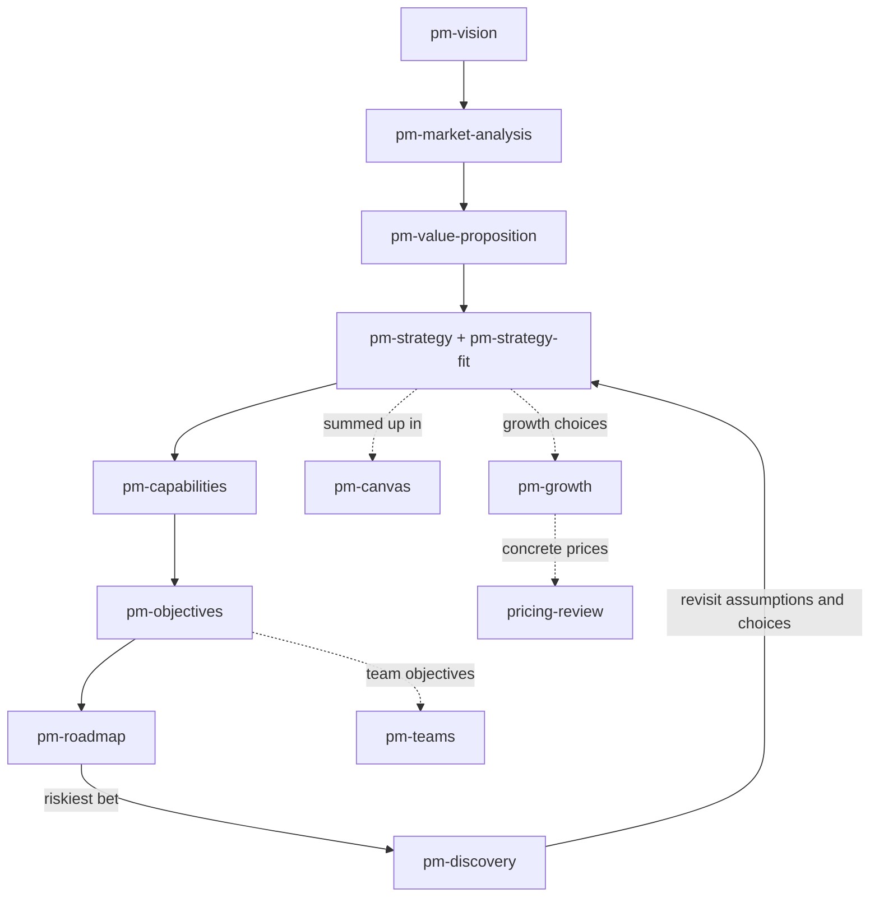
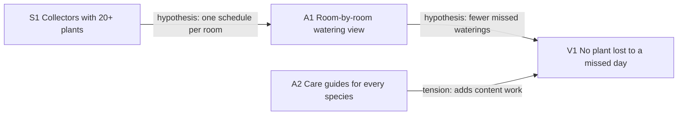
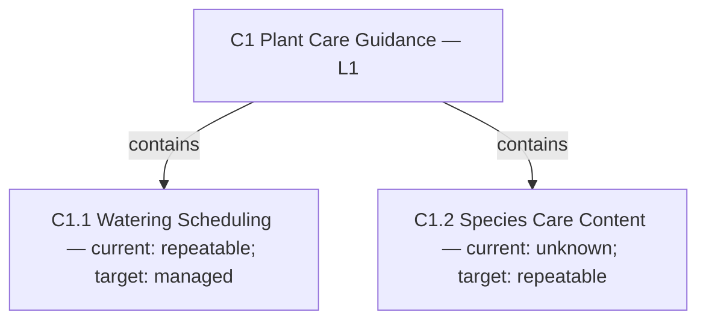

# Product Strategy

A chief product manager and teacher, fourteen focused skills and a business-capability specialist for deciding what to build and why. Built for product managers and for people with no product training: it starts from what you already know, labels evidence and assumptions, explains each choice, and leaves the decisions with you.

---

## The skills

| Skill | Use it when |
|---|---|
| `product-manager` | You want a chief PM to lead the work end to end, or to teach you while you do it. Routes to the skills below. |
| `pm-vision` | Defining a mission, vision, or winning aspiration: what success should mean. |
| `pm-strategy` | Choosing where to play and how to win, and the trade-offs that come with it. |
| `pm-strategy-fit` | Checking that strategic choices reinforce each other and are hard to copy. |
| `pm-canvas` | Filling in, teaching, or reviewing a one-page product strategy canvas. |
| `pm-value-proposition` | Working out customer value, alternatives, and a value curve. |
| `pm-objectives` | Setting OKRs, key metrics, or a North Star metric. Includes a 40-entry metric catalog. |
| `pm-roadmap` | Building an outcome roadmap, prioritizing, or writing a PRD or user stories. |
| `pm-discovery` | Planning interviews, testing assumptions, Kano surveys, journey maps, or A/B tests. |
| `pm-growth` | Acquisition, activation, retention, referral loops, and monetization. |
| `pricing-review` | Reviewing pricing and packaging, or before changing prices: value metric, tiers, willingness-to-pay evidence, a sourced competitor scan, and a grandfathering plan for existing customers. |
| `pm-market-analysis` | Five Forces, PESTLE, SWOT, and other views of the market around you. |
| `pm-capabilities` | Mapping the business capabilities a strategy needs, and the gaps. |
| `pm-teams` | Setting up empowered product teams and team-level objectives. |
| `pm-visuals` | Turning any of the above into a diagram (Mermaid by default) or an HTML page. |

Two Claude Code agents ship alongside: `product-manager` (the same chief PM, in its own context) and `business-capability-modeler`.

---

## Rule ownership

`product-manager` owns sequencing and teaching; each `pm-*` skill owns one artifact. When two could fire, the more specific skill wins: "draft our OKRs" goes to `pm-objectives`, "help me figure out what to do next with this product" goes to `product-manager`. `pm-visuals` never decides content; it draws what the other skills produced. `pricing-review` owns price points, tiers, and price-change migration; `pm-growth` owns monetization as part of the growth model and hands concrete pricing to it.

---

## What it looks like

<details>
<summary>Compatibility at a glance</summary>

| Skill | Claude Code | Claude app | Codex | ChatGPT | Other agents |
|---|---|---|---|---|---|
| pm-canvas | ✔ | ◐ | ✔ | ✔ | ✔ |
| pm-capabilities | ✔ | ◐ | ✔ | ✔ | ✔ |
| pm-discovery | ✔ | ◐ | ✔ | ✔ | ✔ |
| pm-growth | ✔ | ◐ | ✔ | ✔ | ✔ |
| pm-market-analysis | ✔ | ◐ | ✔ | ✔ | ✔ |
| pm-objectives | ✔ | ◐ | ✔ | ✔ | ✔ |
| pm-roadmap | ✔ | ◐ | ✔ | ✔ | ✔ |
| pm-strategy | ✔ | ◐ | ✔ | ✔ | ✔ |
| pm-strategy-fit | ✔ | ◐ | ✔ | ✔ | ✔ |
| pm-teams | ✔ | ◐ | ✔ | ✔ | ✔ |
| pm-value-proposition | ✔ | ◐ | ✔ | ✔ | ✔ |
| pm-vision | ✔ | ◐ | ✔ | ✔ | ✔ |
| pm-visuals | ✔ | ◐ | ✔ | ✔ | ✔ |
| pricing-review | ✔ | ✔ | ✔ | ✔ | ◐ |
| product-manager | ✔ | ◐ | ✔ | ✔ | ✔ |

✔ full · ◐ partial · ✖ no. What each host means, and the limits behind each mark: [Compatibility](../../README.md#compatibility).

</details>

The usual order of work. Solid arrows are the main path; dotted arrows are branches you take when the work calls for them. `product-manager` can route you to any step, and `pm-visuals` can draw any step. Discovery feeds back into strategy: evidence can change earlier choices.



Each example below is a short sample of a skill's output. They all use one invented product, **Plant Ledger**, a watering tracker for people with large houseplant collections, so you can follow it from step to step. The numbers, people, and evidence are made up. The diagrams follow the conventions in `pm-visuals`: stable IDs, a status on every claim, and labelled arrows. Its [diagram templates](skills/pm-visuals/references/templates.md) and [offline gallery](skills/pm-visuals/examples/diagram-gallery.html) show all nine diagram types.

<details>
<summary><code>product-manager</code>: a guided route through the work</summary>

[](../../README.md#compatibility) [](../../README.md#compatibility) [](../../README.md#compatibility)

> **Limits.** Claude app: Each upload is one skill folder, so the shared-principles file this skill reads from a sibling skill is missing unless you bundle it in.

**Use it when:** You have a product idea and do not know what to work on first.

**Try:** `I built a recipe-sharing app for home cooks. Where do I start?`

**Skip it when:** You already know which single artifact you need, such as OKRs or a roadmap.

Example exchange, invented data (fictional product).

```text
You:    I built a watering tracker for houseplant collectors. What should I do next?

Agent:  Route: why it exists > where to compete > customer value > measures > roadmap
        Current step: why it exists, and for whom
        Draft:    help collectors with 20+ plants stop losing plants to a missed watering
        Option A: hobby collectors   (evidence: all 40 beta users collect plants)
        Option B: small plant shops  (hypothesis: no shop has used it yet)
        Recommend A, because the evidence supports it. B stays open as a later test.
        Unknown:  whether people keep using it after week 2 (no data yet)
        One question for you: is this a paid product, or a personal tool for now?
```

</details>

<details>
<summary><code>pm-vision</code>: mission, vision, and winning aspiration</summary>

[](../../README.md#compatibility) [](../../README.md#compatibility) [](../../README.md#compatibility)

> **Limits.** Claude app: Each upload is one skill folder, so the shared-principles file this skill reads from a sibling skill is missing unless you bundle it in.

**Use it when:** You must say what your product is for and what success means.

**Try:** `Help me write a mission and vision for my plant watering tracker.`

**Skip it when:** Your mission is agreed and you need to pick a market segment.

Example output, invented data (fictional product).

```text
Context      40 beta users, all hobby collectors (evidence); paying intent unknown
Mission      Plant Ledger helps people with big houseplant collections keep every
             plant on schedule, without a spreadsheet.
Vision       Collectors spend their plant time on growing, not remembering.
Winning      The tracker collectors with 20+ plants recommend to each other first.
Alternatives (a) every plant owner: broader, but no reason to pick us
             (b) plant shops: real need, but no evidence yet
Boundaries   Not a plant shop, not a plant-ID app, not a social network
Stress test  Could a competitor say this unchanged? Partly: "20+ plants" is the sharp part
Next         Decide where to compete. A 20-person survey could change this choice
```

</details>

<details>
<summary><code>pm-strategy</code>: where to play, how to win, and the trade-offs</summary>

[](../../README.md#compatibility) [](../../README.md#compatibility) [](../../README.md#compatibility)

> **Limits.** Claude app: Each upload is one skill folder, so the shared-principles file this skill reads from a sibling skill is missing unless you bundle it in.

**Use it when:** You must choose which users to serve and how to win with them.

**Try:** `Should my tracker target hobby collectors or small plant shops?`

**Skip it when:** You only need a mission statement or a pricing table.

Example output, invented data (fictional product).

```text
Recommendation  Differentiation focus: a narrow segment with distinct needs
Five connected choices
  Winning aspiration  first tracker collectors recommend to each other
  Where to play       collectors with 20+ indoor plants; English-speaking; app stores
  How to win          room-by-room schedules that survive travel and season changes
  Capabilities        schedule engine, species care data, reliable reminders
  Management systems  weekly review of missed-watering reports; one owner
Trade-off      Chosen: depth for collectors. Rejected: a simple app for everyone
               Sacrificed: casual owners with 3 plants (deliberate exclusion)
Riskiest assumption  collectors will pay for schedules (hypothesis, untested)
Change trigger       fewer than 1 in 10 trial users set up a second room
```

</details>

<details>
<summary><code>pm-strategy-fit</code>: do the choices reinforce each other?</summary>

[](../../README.md#compatibility) [](../../README.md#compatibility) [](../../README.md#compatibility)

> **Limits.** Claude app: Each upload is one skill folder, so the shared-principles file this skill reads from a sibling skill is missing unless you bundle it in.

**Use it when:** You have strategic choices and want to know if they fit together and resist copying.

**Try:** `Stress test my strategy: could a bigger app copy it?`

**Skip it when:** You have not made any strategic choices yet.

Example output, invented data (fictional product). This activity-system diagram uses the `pm-visuals` convention: each arrow is labelled as a hypothesis or a tension.



| Choice A | Choice B | Link | Mechanism | Evidence |
|---|---|---|---|---|
| S1 Collectors | A1 Room view | reinforcing | big collections span rooms | 31 of 40 beta users set up 2+ rooms |
| A2 Care guides | S1 Collectors | conflicting | collectors already know their species | 2 interviews; untested |

Verdict: revise A2 before committing. Competitors *can* copy A1; a general plant app *won't*, because it would complicate setup for casual owners.

</details>

<details>
<summary><code>pm-canvas</code>: a one-page strategy canvas</summary>

[](../../README.md#compatibility) [](../../README.md#compatibility) [](../../README.md#compatibility)

> **Limits.** Claude app: Each upload is one skill folder, so the shared-principles file this skill reads from a sibling skill is missing unless you bundle it in.

**Use it when:** You want the whole strategy on one page for a team review.

**Try:** `Fill in a strategy canvas for my plant watering tracker.`

**Skip it when:** You need depth on one choice, such as a full value curve.

Example output, invented data (fictional product). Every entry carries a status: evidence-backed, hypothesis, or accepted.

```text
PRODUCT STRATEGY CANVAS: Plant Ledger         Status: Draft
1 Winning aspiration  First tracker collectors recommend          [hypothesis]
2 Where to play       Collectors with 20+ indoor plants           [evidence-backed]
                      Not: casual owners, plant shops (for now)   [accepted]
3 How to win          Room-by-room schedules that survive travel  [hypothesis]
                      Who could copy it? Any app. Why won't they? Setup cost for casual users
4 Capabilities        Schedule engine (have it); care data (do not have it)
5 Management systems  Weekly missed-watering review, one owner    [accepted]
Key measures          Collectors still active at week 4: baseline unknown
Open assumptions      The app actually has every capability claimed in section 4: check against what has shipped
Main strategic fork   Collectors over everyone: gives up the mass market
```

</details>

<details>
<summary><code>pm-value-proposition</code>: customer value and a value curve</summary>

[](../../README.md#compatibility) [](../../README.md#compatibility) [](../../README.md#compatibility)

> **Limits.** Claude app: Each upload is one skill folder, so the shared-principles file this skill reads from a sibling skill is missing unless you bundle it in.

**Use it when:** You must explain why customers would pick you over what they use today.

**Try:** `Write a value proposition and value curve for my plant tracker versus spreadsheets.`

**Skip it when:** You need a price or a tier list.

Example output, invented data (fictional product). The statement follows the frame in the working sheet. An unknown rating stays unknown; it is never plotted as zero.

```text
Statement  For collectors working through a weekly watering round of 20+ plants,
           Plant Ledger helps them never miss a watering by building a schedule
           for each room, addressing what a calendar app leaves unsatisfied (it
           only repeats fixed dates), supported by 6 interviews about plants lost
           after a trip (validation still needed)

Value curve data (1 = low, 5 = high; P = proposed target)
Factor               Calendar app   Spreadsheet   Plant Ledger now   Plant Ledger target
Setup effort*        2              4             3                  2 (P)
Per-room schedules   1              3             4                  5 (P)
Species care advice  1              1             unknown            3 (P)
* lower is better
Eliminate: social feed   Raise: travel mode   Create: room schedules
```

</details>

<details>
<summary><code>pm-objectives</code>: OKRs with baselines and guardrails</summary>

[](../../README.md#compatibility) [](../../README.md#compatibility) [](../../README.md#compatibility)

> **Limits.** Claude app: Each upload is one skill folder, so the shared-principles file this skill reads from a sibling skill is missing unless you bundle it in.

**Use it when:** You must set goals for a quarter and say how you will measure them.

**Try:** `Draft OKRs for next quarter for my plant tracker, with baselines.`

**Skip it when:** You want a ranked list of features to build.

Example output, invented data (fictional product). A baseline nobody has measured is marked unknown, not guessed.

| Objective: collectors keep every plant on schedule (Q3) | Type | Baseline | Target | Status |
|---|---|---|---|---|
| KR1 Share of active collectors with 2+ rooms set up | outcome | 31 of 40 (beta) | 60% of new users | provisional |
| KR2 Missed waterings per collector per month | outcome | unknown | measure first | instrument by week 2 |
| KR3 Reminder delivered within 1 hour of due time | input | 92% | 99% | provisional |
| Guardrail: notifications turned off within 7 days | guardrail | unknown | no increase | watch |

Review rule: if KR1 is flat after 6 weeks, stop the onboarding bet and investigate.

</details>

<details>
<summary><code>pm-roadmap</code>: an outcome roadmap, Now / Next / Later</summary>

[](../../README.md#compatibility) [](../../README.md#compatibility) [](../../README.md#compatibility)

> **Limits.** Claude app: Each upload is one skill folder, so the shared-principles file this skill reads from a sibling skill is missing unless you bundle it in.

**Use it when:** You have many requests and need to order them by outcome.

**Try:** `Build a Now, Next, Later roadmap from my backlog of 12 feature requests.`

**Skip it when:** You have no objectives yet and cannot say what outcome you want.

Example output, invented data (fictional product). Uses the `pm-visuals` outcome-roadmap layout. Later items stay tentative.

| Now | Next | Later |
|---|---|---|
| O1 More collectors set up 2+ rooms; test a guided room setup; exit when 60% of new users reach 2 rooms | O2 Fewer missed waterings while traveling; depends on O1 finding | O3 Plant shops as a second segment (option); revisit if 5 shops ask |
| Discovery: 5 interviews on why people skip room setup | Delivery: travel mode, first slice | Measurement: shop interest log |

Dates: none are commitments. Week 6 review is an estimate.

</details>

<details>
<summary><code>pm-discovery</code>: an experiment card with decisions</summary>

[](../../README.md#compatibility) [](../../README.md#compatibility) [](../../README.md#compatibility)

> **Limits.** Claude app: Each upload is one skill folder, so the shared-principles file this skill reads from a sibling skill is missing unless you bundle it in.

**Use it when:** You have a risky assumption and want the smallest test for it.

**Try:** `Plan five interviews to test whether collectors forget to water plants.`

**Skip it when:** You already have strong evidence and only need to schedule the work.

Example output, invented data (fictional product).

```text
EXPERIMENT CARD E1
Hypothesis   Collectors will set up 2+ rooms if setup is guided, step by step
Assumption   value (they want room schedules), usability (setup is the blocker)
Segment      new sign-ups with 20+ plants
Method       guided setup shown to new sign-ups for 2 weeks; observe behaviour
Metric       share reaching 2+ rooms within 3 days; baseline unknown
Threshold    proposed 50%; rationale: half of collectors own plants in 2+ rooms
Cost         2 days of build; no outreach, no charge to users
Pass         ship guided setup to everyone
Fail         interview 5 who quit setup before building more
Inconclusive extend 2 weeks once, then decide
Limit        says nothing about payment or long-term retention
```

</details>

<details>
<summary><code>pm-growth</code>: a growth loop and the current constraint</summary>

[](../../README.md#compatibility) [](../../README.md#compatibility) [](../../README.md#compatibility)

> **Limits.** Claude app: Each upload is one skill folder, so the shared-principles file this skill reads from a sibling skill is missing unless you bundle it in.

**Use it when:** Users sign up but few come back, and you want to find the weakest step.

**Try:** `Where is my growth stuck? 200 sign-ups, 30 still active after a month.`

**Skip it when:** You want a price change. Use pricing-review for that.

Example output, invented data (fictional product). A loop only counts once its repeat behaviour has evidence; this one is a hypothesis.

```text
Growth objective   sustained use by collectors, not raw downloads
Constraint         activation: 55% of sign-ups never add a second room (evidence)
Proposed loop      collector shares a room schedule (input)
                   > a friend imports it and waters on time (value-producing action)
                   > the friend joins and shares their own rooms (output)
                   > more shared schedules to import (return to input)
Why it might repeat  collectors already swap cuttings and care tips
Saturation limit     small, tight-knit hobby circles
Channel test       one collector forum, 4 weeks, owner: founder
Guardrail          no auto-invites; sharing is always opt-in
Economics          acquisition cost unknown; no lifetime value until 3 months of data
```

</details>

<details>
<summary><code>pricing-review</code>: a one-page pricing recommendation</summary>

[](../../README.md#compatibility) [](../../README.md#compatibility) [](../../README.md#compatibility)

> **Limits.** Other agents: Web search is the core step; Gemini CLI/Antigravity CLI, Cursor and opencode (with a search provider) have it, Copilot, Windsurf and Cline are not verified.

**Use it when:** You plan to change prices or tiers on a product with paying customers.

**Try:** `Review my pricing before I raise the Collector plan from $4 to $6.`

**Skip it when:** Your product has no paying customers and no price idea yet.

Example output, invented data (fictional product). There is no willingness-to-pay evidence yet, so these prices are untested proposals.

| Tier | Price | Limits | Who it is for |
|---|---|---|---|
| Free | $0 | 1 room, 15 plants | trying it out |
| Collector | $4 / month | unlimited rooms, travel mode | collectors with 20+ plants |

```text
Value metric      rooms tracked, because value grows with the size of the collection
Evidence          no evidence yet: run a willingness-to-pay test before setting prices
Competitor anchor two plant apps, pricing pages linked and fetched today; one is
                  "contact us", so it is recorded as unknown
Migration         not applicable: no paying users yet
Risks             collectors with 1 big room never hit the limit; room count may be the wrong metric
```

</details>

<details>
<summary><code>pm-market-analysis</code>: a SWOT, with evidence for each item</summary>

[](../../README.md#compatibility) [](../../README.md#compatibility) [](../../README.md#compatibility)

> **Limits.** Claude app: Each upload is one skill folder, so the shared-principles file this skill reads from a sibling skill is missing unless you bundle it in.

**Use it when:** You want to understand the market and rivals around your product.

**Try:** `Run a SWOT for my plant tracker, with a source for each point.`

**Skip it when:** You want to choose a strategy. Use pm-strategy for that.

Example output, invented data (fictional product). Uses the `pm-visuals` SWOT layout: internal versus external, helpful versus harmful.

| | Helpful | Harmful |
|---|---|---|
| Internal | S1 Room schedules already work (31 of 40 beta users use them) | W1 No species care data |
| External | O1 Collector forums are growing (fictional forum stats, 2026) | T1 Phone makers add basic plant reminders (unverified) |

Combinations: S1 + O1 suggests a forum test of shared schedules. W1 + T1 is a risk: test whether collectors need care data at all before building it.

</details>

<details>
<summary><code>pm-capabilities</code>: a capability map with current and target states</summary>

[](../../README.md#compatibility) [](../../README.md#compatibility) [](../../README.md#compatibility)

> **Limits.** Claude app: Each upload is one skill folder, so the shared-principles file this skill reads from a sibling skill is missing unless you bundle it in.

**Use it when:** You want to know which abilities your business needs to deliver the strategy.

**Try:** `Map the capabilities my plant tracker needs and show the gaps.`

**Skip it when:** You have no strategy yet, so there is nothing to map against.

Example output, invented data (fictional product). Uses the `pm-visuals` capability-hierarchy template. An arrow means "contains", not "reports to".



Gap: C1.2 is unknown, because nobody has checked it yet. Options: build it, license it, or defer it until discovery shows collectors need it.

</details>

<details>
<summary><code>pm-teams</code>: a team objective in its strategic context</summary>

[](../../README.md#compatibility) [](../../README.md#compatibility) [](../../README.md#compatibility)

> **Limits.** Claude app: Each upload is one skill folder, so the shared-principles file this skill reads from a sibling skill is missing unless you bundle it in.

**Use it when:** You must set up teams and give each team a clear objective.

**Try:** `Set up objectives for two product teams at my 12-person plant app company.`

**Skip it when:** You work alone and only need a personal task list.

Example output, invented data (fictional product). Two people and one agent, so "team" means the person who owns the problem.

```text
TEAM OBJECTIVE BRIEF
Strategic context  collectors with 20+ plants; win on room-by-room schedules
Problem            new collectors stop before setting up a second room
Measure            share of new users with 2+ rooms in 3 days; baseline unknown
Owner              designer-founder (decides the solution)
Needs sign-off     any change to the target segment or pricing
Dependency         reminder service owned by the other founder
Agent's role       drafts setups and analysis; the owner decides
Experiment         a 15-minute weekly sync on setup drop-off for 4 weeks
Review trigger     after 4 weeks, or sooner if setup drop-off gets worse
```

</details>

<details>
<summary><code>pm-visuals</code>: the shared table behind every diagram</summary>

[](../../README.md#compatibility) [](../../README.md#compatibility) [](../../README.md#compatibility)

> **Limits.** Claude app: Each upload is one skill folder, so the shared-principles file this skill reads from a sibling skill is missing unless you bundle it in.

**Use it when:** You have analysis in a table and want a diagram or HTML page of it.

**Try:** `Draw a Mermaid diagram of my value curve table.`

**Skip it when:** You have no analysis yet. Do the analysis first.

Example output, invented data (fictional product). Each diagram starts from a small table with stable IDs and a status on each row. The diagram, the table, and the analysis all use the same IDs.

| ID | Statement | Status | Evidence / date | Implication |
|---|---|---|---|---|
| S1 | Collectors with 20+ plants are the segment | choice | 40 beta users, 2026-05 | room features come first |
| A1 | Room-by-room view cuts missed waterings | hypothesis | none yet | test E1 |
| C1.2 | Species care content | unknown | not assessed | do not plot as zero |

See the [templates](skills/pm-visuals/references/templates.md) for all nine layouts and the [gallery](skills/pm-visuals/examples/diagram-gallery.html) for worked examples that open offline.

</details>

---

## Install

### Claude Code

```
/plugin marketplace add stylusnexus/agent-plugins
/plugin install product-strategy@stylus-nexus
```

Skills are namespaced: `/product-strategy:product-manager`.

### Codex

```
codex plugin marketplace add stylusnexus/agent-plugins
codex plugin add product-strategy@stylus-nexus
```

In Codex, type `$` and a skill name to use it (`$product-strategy:product-manager`; Codex prefixes plugin skills with the pack name), or run `/skills` to pick one.

### Everything else — Cursor, Copilot, Gemini CLI, Windsurf, Zed, opencode, Cline, Continue, Hermes, and ~60 more

```bash
npx skills add stylusnexus/agent-plugins --skill pm-canvas pm-capabilities pm-discovery pm-growth pm-market-analysis pm-objectives pm-roadmap pm-strategy pm-strategy-fit pm-teams pm-value-proposition pm-vision pm-visuals pricing-review product-manager
```

Skills arrive un-namespaced on this path, so most agents invoke them as `/product-manager`; Windsurf uses `@product-manager`, opencode shows `/product-manager` only when the skill sets an opencode-specific metadata field, and Gemini CLI activates a skill itself after you approve it.

## Prerequisites

None for the skills. The two optional scripts live in this pack's `scripts/` folder, outside every skill folder, so a Skills CLI install or a Claude app upload does not include them. They need Python 3 and the standard library only: `scripts/metrics_lookup.py` searches the metric catalog, and `scripts/discovery_digest.py` summarizes a local file of research evidence. Neither makes network calls.

## Sources

Methods are credited to their originators, and every source is public. See the [source list](skills/product-manager/references/sources.md).
