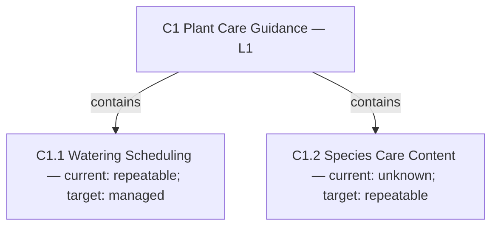

<!-- skill-readme:begin -->
# pm-capabilities

This skill should be used when the user asks for business capability modeling, a capability map, L1/L2 capabilities, current versus target capabilities, capability maturity, strategic capability gaps, or build/buy/partner choices.

[](../../../../README.md#compatibility) [](../../../../README.md#compatibility) [](../../../../README.md#compatibility)

> **Limits.** Claude app: Each upload is one skill folder, so the shared-principles file this skill reads from a sibling skill is missing unless you bundle it in.

Part of the [product-strategy](../../README.md) pack.

## When and how to use it

**Use it when:** You want to know which abilities your business needs to deliver the strategy.

**Try:** `Map the capabilities my plant tracker needs and show the gaps.`

**Skip it when:** You have no strategy yet, so there is nothing to map against.

## What it looks like

Example output, invented data (fictional product). Uses the `pm-visuals` capability-hierarchy template. An arrow means "contains", not "reports to".



Gap: C1.2 is unknown, because nobody has checked it yet. Options: build it, license it, or defer it until discovery shows collectors need it.

## Install

This skill reads shared files in its sibling skills, so install the whole product-strategy pack. The Claude Code and Codex plugins do that already; with the Skills CLI or a folder copy, take every skill in the pack.

<details>
<summary>Claude Code (CLI)</summary>

Add the marketplace once, then install the pack:

```bash
claude plugin marketplace add stylusnexus/agent-plugins
claude plugin install product-strategy@stylus-nexus
```

Inside a session, `/plugin marketplace add stylusnexus/agent-plugins` and `/plugin install product-strategy@stylus-nexus` do the same. This installs the whole product-strategy pack, so pm-canvas, pm-discovery, pm-growth, pm-market-analysis, pm-objectives, pm-roadmap, pm-strategy, pm-strategy-fit, pm-teams, pm-value-proposition, pm-vision, pm-visuals, pricing-review and product-manager come with it.

Call it as `/product-strategy:pm-capabilities`, or let it start on its own when your request matches.

</details>

<details>
<summary>Claude Code desktop app</summary>

The desktop app's local sessions read the same plugin settings as the CLI, so a pack you installed from the terminal at user scope is already there.

To install from the app, add the marketplace once from a terminal with `claude plugin marketplace add stylusnexus/agent-plugins`. Then, in a local or SSH session on the **Code** tab, click **+** next to the prompt box, choose **Plugins**, then **Add plugin**, and pick **product-strategy**. Plugins do not load in the app's cloud sessions.

</details>

<details>
<summary>Codex</summary>

```bash
codex plugin marketplace add stylusnexus/agent-plugins
codex plugin add product-strategy@stylus-nexus
```

This installs the whole product-strategy pack, so pm-canvas, pm-discovery, pm-growth, pm-market-analysis, pm-objectives, pm-roadmap, pm-strategy, pm-strategy-fit, pm-teams, pm-value-proposition, pm-vision, pm-visuals, pricing-review and product-manager come with it. In Codex, type `$` and the skill name (`$product-strategy:pm-capabilities`), or run `/skills` to pick it.

</details>

<details>
<summary>Other agents, Skills CLI</summary>

The [Skills CLI](https://github.com/vercel-labs/skills) finds the agents you have and writes the skill into each one's skills folder.

This skill reads shared files in its sibling skills, so install every skill in the pack:

```bash
npx skills add stylusnexus/agent-plugins --skill pm-canvas pm-capabilities pm-discovery pm-growth pm-market-analysis pm-objectives pm-roadmap pm-strategy pm-strategy-fit pm-teams pm-value-proposition pm-vision pm-visuals pricing-review product-manager
```

Skills arrive without a pack prefix: `/pm-capabilities` in most agents and `@pm-capabilities` in Windsurf. opencode shows `/pm-capabilities` only when the skill sets an opencode-specific metadata field, and Gemini CLI starts a skill itself after you approve it.

**Note:** Install the whole pack: this skill reads shared files in a sibling skill.

</details>

<details>
<summary>Other agents, by folder</summary>

`.agents/skills` is read by Codex, Gemini CLI, Antigravity CLI, Cursor, GitHub Copilot, opencode and Windsurf. Claude Code reads `.claude/skills`. Cline does not read `.agents/skills`; use `.cline/skills` or `.claude/skills` there.

Copy every skill in the pack, so the shared files sit beside this one:

```bash
git clone --depth 1 https://github.com/stylusnexus/agent-plugins
mkdir -p .agents/skills
cp -R agent-plugins/plugins/product-strategy/skills/. .agents/skills/
```

**Note:** Install the whole pack: this skill reads shared files in a sibling skill.

</details>

<details>
<summary>Claude app (partial)</summary>

1. Turn on **Code execution and file creation** in **Settings > Capabilities**. On Team and Enterprise plans, an owner controls this.
2. Zip the skill folder, so the ZIP holds the `pm-capabilities` folder:

   ```bash
   git clone --depth 1 https://github.com/stylusnexus/agent-plugins
   cd agent-plugins/plugins/product-strategy/skills
   zip -r pm-capabilities.zip pm-capabilities
   ```

3. In Claude, open **Customize > Skills**, click **+**, then **+ Create skill**, choose **Upload a skill** and pick `pm-capabilities.zip`.

**Limit:** Each upload is one skill folder, so the shared-principles file this skill reads from a sibling skill is missing unless you bundle it in.

</details>

<details>
<summary>ChatGPT</summary>

ChatGPT gets this skill through the Codex plugin, which brings the whole product-strategy pack. Run the two Codex commands above, then in ChatGPT type `@` and the skill name.

</details>
<!-- skill-readme:end -->
