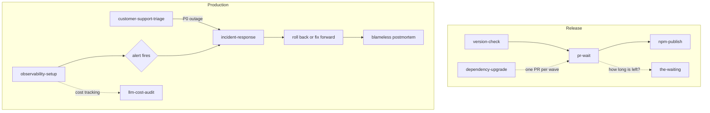

# Release Ops

Nine skills for getting a release out the door and keeping it running — deciding the version, waiting on CI, publishing, keeping dependencies current, watching production, handling incidents and support tickets, and keeping model API spend in check.

---

## The skills

| Skill | Use it when |
|---|---|
| `version-check` | You need to decide the next version. Reads the commits since the last tag and recommends major, minor, or patch, with the reasoning. |
| `pr-wait` | A PR is open and you want to block on CI rather than watch it, optionally merging when checks pass. |
| `the-waiting` | CI is running and you want to know how long is really left, or why a run is still pending. Estimates each job from its own history, spots runs stuck behind a cancelled one, and suggests something small to do meanwhile. Named for Tom Petty's "The Waiting", because it is the hardest part. |
| `npm-publish` | Publishing to npm or bun — preflight checks, semver bump, changelog entry, git push, publish, verify. Rotates an expired npm token through the browser instead of stopping to ask for a one-time code. |
| `observability-setup` | You are launching a service or auditing its monitoring. Wires a health-check endpoint, uptime checks, log forwarding, error tracking, LLM cost tracking, and page-versus-ticket alert thresholds. |
| `incident-response` | A service is down, erroring, or degraded in production. Sets severity, runs a fixed triage order, decides on rollback first, drafts user comms, and writes a one-page blameless postmortem. |
| `dependency-upgrade` | Bulk dependency bumps. Treats them as a gated pipeline — inventory, batch, then type check, test, and E2E between batches — rather than one update command and hope. |
| `customer-support-triage` | A support email or ticket needs handling. Classifies it, tries to reproduce bugs, sets severity, files a GitHub issue with no customer PII, checks refunds against the written policy, and drafts the reply for a person to send. |
| `llm-cost-audit` | The model API bill is high or due a review. Reconciles tracked cost with the provider's bill, checks each call site's model tier, finds caching and batch savings using the provider's current prices, and ends in a savings table. |

---

## Rule ownership

| Skill | Owns |
|---|---|
| `version-check` | Deciding *what* the next version should be |
| `pr-wait` | Waiting on CI for an open PR, and merging on green |
| `the-waiting` | Explaining a wait: time left, stuck runs, and what to do meanwhile. Never cancels, reruns, or merges |
| `npm-publish` | Everything from bump to published artifact, including auth |
| `dependency-upgrade` | Incoming dependency changes and the gates between batches |
| `observability-setup` | Setting up monitoring before anything breaks — health checks, uptime, logs, error tracking, alert thresholds |
| `incident-response` | What to do once something is already broken — severity, triage order, rollback, comms, postmortem |
| `customer-support-triage` | Turning one customer message into a classified, reproduced, PII-free issue and a drafted reply; refund decisions outside policy stay with a person |
| `llm-cost-audit` | What the product pays for model calls, and the savings table |

**`observability-setup` runs before an incident; `incident-response` runs during and after one.** The alerts you wire up first are what tell you to start the second. `observability-setup` sets up product analytics events only to the extent a health signal needs them; the event taxonomy belongs to `analytics-instrumentation` in the `ship-pipeline` pack.

**`customer-support-triage` handles one customer's report; `incident-response` handles a live outage.** A P0 ticket that turns out to be an outage is handed to `incident-response`. `observability-setup` wires LLM cost tracking; `llm-cost-audit` reads it and decides what to change.

**`version-check` recommends; `npm-publish` executes.** Run the first when you want the decision explained, the second when you've made it. `npm-publish` will bump on its own, so pairing them is optional rather than required.

`pr-wait` overlaps slightly with the `ship-pipeline` pack's `review-merge-pipeline`, which also pushes, opens a PR, and merges. The split: **`review-merge-pipeline` owns the whole path from unreviewed changes to merged; `pr-wait` owns only the tail** — a PR already exists, and you want to block on its checks. Reach for `pr-wait` when someone else opened the PR, or when you deliberately stopped at PR creation.

For repository activity summaries — what shipped, what's open, CI health — use `/work-plan:repo-activity-summary` from the `work-plan` plugin rather than looking for it here.

---

## What it looks like

<details>
<summary>Compatibility at a glance</summary>

| Skill | Claude Code | Claude app | Codex | ChatGPT | Other agents |
|---|---|---|---|---|---|
| customer-support-triage | ✔ | ◐ | ✔ | ◐ | ✔ |
| dependency-upgrade | ✔ | ✖ | ✔ | ✖ | ✔ |
| incident-response | ✔ | ◐ | ✔ | ◐ | ✔ |
| llm-cost-audit | ✔ | ◐ | ✔ | ◐ | ✔ |
| npm-publish | ✔ | ✖ | ✔ | ✖ | ✔ |
| observability-setup | ✔ | ◐ | ✔ | ◐ | ✔ |
| pr-wait | ✔ | ✖ | ✔ | ✖ | ✔ |
| the-waiting | ✔ | ✖ | ✔ | ✖ | ✔ |
| version-check | ✔ | ◐ | ✔ | ◐ | ✔ |

✔ full · ◐ partial · ✖ no. What each host means, and the limits behind each mark: [Compatibility](../../README.md#compatibility).

</details>

The release path on top, the production path below it.



Open a skill below to see a short sample of what it produces. Every sample is invented: the packages, issue numbers, services and figures are made up.

<details>
<summary><code>version-check</code>: the bump recommendation</summary>

[](../../README.md#compatibility) [](../../README.md#compatibility) [](../../README.md#compatibility)

> **Limits.** Claude app and ChatGPT: Can judge a pasted diff or commit list; cannot read git history itself.

**Use it when:** You have commits since the last tag and must pick major, minor or patch.

**Try:** `Should the next release of acme-sdk be a major, minor or patch bump?`

**Skip it when:** The release is already decided and you only want to publish. Use `npm-publish`.

Example output, invented data.

```text
Version Check Report
====================
Current version: 2.4.1
Last tag: v2.4.1
Commits since tag: 7

Recommendation: MINOR bump -> 2.5.0
Reason: new backward-compatible features, no breaking changes

Evidence:
  - src/index.ts: added export createBatchClient (an addition, not a removal)
  - src/types/index.ts: new optional field timeoutMs? on ClientOptions
  - no commit message contains BREAKING CHANGE or feat!:

Changed files:
  src/index.ts (modified)
  src/batch.ts (added)
  src/types/index.ts (modified)

Bump to 2.5.0? Nothing changes until you confirm.
```

</details>

<details>
<summary><code>pr-wait</code>: status lines, and why it did not merge</summary>

[](../../README.md#compatibility) [](../../README.md#compatibility) [](../../README.md#compatibility)

> **Limits.** Claude app: Needs gh and your local repo. ChatGPT: No access to your local repo or git and gh credentials by default.

**Use it when:** A pull request is open and you want to wait for its CI checks, and maybe merge on green.

**Try:** `/pr-wait 318 true 30`

**Skip it when:** No pull request exists yet, or you want help with the review itself.

Example output, invented data.

```text
Monitoring PR #318 CI checks...
Check interval: 60s | Max wait: 20 minutes | Auto-merge: enabled

=== Initial Status ===
✅ Build and Test: pass
⏳ E2E Tests: pending

[1] 10:14:00 - 1 check still running:
  ⏳ E2E Tests

[2] 10:15:00 - All checks complete!

=== Final Status ===
✅ Build and Test: pass
❌ E2E Tests: fail

Checks failed: E2E Tests. Not merging PR #318.
```

</details>

<details>
<summary><code>the-waiting</code>: time left, and something to do meanwhile</summary>

[](../../README.md#compatibility) [](../../README.md#compatibility) [](../../README.md#compatibility)

> **Limits.** Claude app: Runs in a remote sandbox without your local repo, git remotes or credentials. ChatGPT: No access to your local repo or git and gh credentials by default.

**Use it when:** CI has been pending for a while and you want to know how long is left.

**Try:** `/the-waiting 318`

**Skip it when:** You want to cancel, rerun or merge. This skill only reports.

Example output, invented data.

```text
Unit Tests (full suite): 18m elapsed, usually 26m (p90 31m, 14 runs) → ~8m left.
Lint: 2m elapsed, usually 3m (p90 4m, only 4 runs, so rough) → ~1m left.
Type Check: done ✓.  Nothing stuck.

Sound check is running long; the drummer is still looking for his sticks.

Meantime, each under five minutes:
  - PR #233 is waiting on your review
  - your PR #229 has a stale lint check
  - issue #241 (typo on the settings page) is assigned to you
```

</details>

<details>
<summary><code>npm-publish</code>: what each script result leads to</summary>

[](../../README.md#compatibility) [](../../README.md#compatibility) [](../../README.md#compatibility)

> **Limits.** Claude app: Publishing needs a local repo, npm and Chrome. ChatGPT: No access to your local repo or git and gh credentials by default.

**Use it when:** You are ready to release an npm package: bump, changelog, push and publish.

**Try:** `Publish acme-sdk as a patch release.`

**Skip it when:** You only want a bump recommendation, or you need a GitHub release. Use `version-check` for the first.

The scripts print a status code; the agent reads it and tells you what happens next.

| Script prints | What the agent does |
|---|---|
| `CONFIRM_PUSH` | Shows what it will commit and push, and waits for your yes |
| `DIRTY_TREE` | Lists tracked files with uncommitted changes and asks what to do; nothing is pushed or published until the tree is clean |
| `CONFIRM_PUBLISH:<package>:<version>` | Asks you to approve the publish before anything goes to npm |
| `PUBLISH_SUCCESS` | Runs the registry check in the background |
| `AUTH_FAILED` | Starts the token setup, in two phases |
| `AGENT_BROWSER_MISSING:<version>` | Asks before installing that exact agent-browser version |
| `FORM_READY:<username>` | Tells you to pick the package and click **Generate token** in Chrome |
| `NOT_LOGGED_IN` | Asks you to sign in to npmjs.com in Chrome, then retries |
| `FORM_NOT_FOUND` | Says it could not find the token form |
| `TOKEN_SAVED` | Retries the publish |
| `CAPTURE_TIMEOUT` | Asks you to click Copy in Chrome and run `setup-token.sh from-clipboard` yourself, so the token never enters the chat |

It never asks you for a one-time code.

</details>

<details>
<summary><code>observability-setup</code>: an audit of an existing service</summary>

[](../../README.md#compatibility) [](../../README.md#compatibility) [](../../README.md#compatibility)

> **Limits.** Claude app and ChatGPT: Writes the health route and alert table; the done criteria need the live host, monitor and error tracker.

**Use it when:** You launch a new web service, or you get paged too often and want better alerts.

**Try:** `Audit the monitoring on our orders-api service and tell me what is missing.`

**Skip it when:** The service is already down. Use `incident-response`.

Example output, invented data.

```text
Monitoring audit: notes-api (existing service)
[x] GET /api/health returns 200 with the DB up, 503 with it down (both tested)
[ ] Host health check path not set: a deploy that can't reach the DB still gets traffic
[x] Uptime monitor on /api/health every 1 min, confirmation period 2 min, pages on-call
[ ] No test log line in the log tool: the log stream is not configured
[x] Test exception visible in the error tracker with area=billing
[ ] Alert table still has the template numbers; not agreed with whoever gets paged

Gaps: 3. Set the health check path first.
```

</details>

<details>
<summary><code>incident-response</code>: severity ladder, triage notes and the user message</summary>

[](../../README.md#compatibility) [](../../README.md#compatibility) [](../../README.md#compatibility)

> **Limits.** Claude app and ChatGPT: Severity, triage, comms and postmortem from pasted information; no log or monitor access and no rollback.

**Use it when:** A production service is down or erroring and you need a fixed order of steps.

**Try:** `The site is returning 500 errors since the last deploy. Run incident response.`

**Skip it when:** The problem is a slow build or a failing test on your laptop.

| Level | Definition | Response time |
|---|---|---|
| S1 | Full outage, data loss risk, or payment/auth broken | Immediate, drop everything |
| S2 | Major feature broken, some users affected, no data risk | Within the hour |
| S3 | Minor bug, cosmetic, workaround exists | Next business day |

Unsure between S1 and S2? Treat it as S1.

Example output, invented data.

```text
Alert 14:02 UTC (uptime: notes-api down). Acknowledged, not resolved. Severity: S1.
Triage
  1. Uptime monitor: every region failing; not a monitor false positive
  2. Host logs, last 30 min: 5xx spike from 13:58, crash-loop restarts
  3. Error tracker: new TypeError in the session middleware
  4. Recent deploys: one at 13:55, 7 minutes before the alert
Decision: the deploy lines up and the cause isn't clear in 5 min → roll back first
  Host rollback to the 13:10 deploy. Auto-deploy is now off; re-enable after the fix.
  git revert 9f3c2e1, pushed, so the branch matches what is running
Recovery: green, error rate at baseline 14:19–14:31 (12 min) → resolved

Status page draft:
  We're aware of an issue affecting sign-in and are actively working on it.
  Your data is safe. We'll update this within 30 minutes.
Postmortem due by 14:02 UTC tomorrow; follow-ups filed as #455 and #456.
```

</details>

<details>
<summary><code>dependency-upgrade</code>: the wave plan and gate results</summary>

[](../../README.md#compatibility) [](../../README.md#compatibility) [](../../README.md#compatibility)

> **Limits.** Claude app: Runs in a remote sandbox without your local repo, git remotes or credentials. ChatGPT: No access to your local repo or git and gh credentials by default.

**Use it when:** `npm outdated` lists many packages and you want safe upgrades in small waves.

**Try:** `Upgrade our outdated dependencies in waves and open one PR per wave.`

**Skip it when:** You need one package bumped by hand, or you want to publish a release.

Example output, invented data.

```text
Wave plan (from npm outdated --json)
package              current   target    risk    wave
@types/node          22.7.4    22.7.9    patch   1
zod                  3.23.6    3.23.8    patch   1
eslint-plugin-react  7.35.0    7.37.2    minor   2
next                 14.2.15   15.0.3    major   3 (with eslint-config-next)
eslint-config-next   14.2.15   15.0.3    major   3

Gates per wave: tsc --noEmit → tests → npx playwright test, then exposure-scan
Wave 1  PASS  all gates green, exposure-scan clean → chore(deps): bump patch dependencies
Wave 2  PASS  all gates green, exposure-scan clean → chore(deps): bump eslint plugins
Wave 3  FAIL  tsc red; green on the base commit, so the bump caused it. Not shipped.
```

</details>

<details>
<summary><code>customer-support-triage</code>: a triage summary and a drafted reply</summary>

[](../../README.md#compatibility) [](../../README.md#compatibility) [](../../README.md#compatibility)

> **Limits.** Claude app and ChatGPT: Classifies and drafts from a pasted ticket; no reproduction, error-tracker search or issue filing.

**Use it when:** A customer email arrived and you need it classified, filed, and a reply drafted.

**Try:** `Triage this support email: the customer says the export button does nothing.`

**Skip it when:** The message is a sales lead, or you want the reply sent for you. It files the GitHub issue but only drafts the reply.

Example output, invented data.

```text
P0: possible double charge on ticket #5120.

Category: Billing (also tagged bug)
Severity: P0 - two charges for the same billing period
Checked: the billing provider shows two successful charges 4 minutes apart
  on one subscription; the error tracker shows a webhook retry at that time
Issue: #461 filed from the template, "Reported by: ticket #5120", existing
  bug and priority labels. No name or email in the body.
Refund: inside the written policy (duplicate charge). Prepared, not issued:
  $12.00, the second charge, reason "duplicate". Waiting for a person to confirm.

DRAFT reply, for the support owner to send:
  Thanks for flagging this. You were charged twice for October, and that's
  on us. We've prepared a refund of $12.00 for the duplicate charge and will
  confirm once it's issued. We're also fixing the cause.
```

</details>

<details>
<summary><code>llm-cost-audit</code>: the savings table with the arithmetic shown</summary>

[](../../README.md#compatibility) [](../../README.md#compatibility) [](../../README.md#compatibility)

> **Limits.** Claude app and ChatGPT: Works on uploaded bills, usage exports and pasted call sites; no search across the repo.

**Use it when:** Your model API bill is high and you want to know where the money goes.

**Try:** `Audit our AI spend and show the savings with the arithmetic.`

**Skip it when:** You only want to pick a model for one new task.

Example output, invented data. Prices are illustrative, not current; the skill reads them from each provider's pricing page on the day of the audit.

```text
Spend: tracked $2,430/mo, billed $2,610/mo. Gap of $180: the retry path in
  jobs/retry.ts:22 skips the tracking wrapper (fix: wrap it).

classify-ticket, top tier → small tier (50 sampled outputs, no regression)
  now:   (1,200 × $5 + 20 × $25) / 1M = $0.0065 × 300,000 calls = $1,950/mo
  after: (1,200 × $1 + 20 × $5)  / 1M = $0.0013 × 300,000 calls =   $390/mo
nightly-tagging, mid tier, synchronous → batch API at 50%
  now:   (3,000 × $2 + 200 × $10) / 1M = $0.008 × 60,000 calls = $480/mo → $240/mo

Finding                  Current   Action                Savings   Price source
classify on top tier     $1,950    route to small tier   $1,560    pricing URL, date read
nightly tagging is sync    $480    move to batch API       $240    pricing URL, date read
Total                    $2,430                          $1,800
Safe to ship now: routing. Needs a test pass first: batch.
```

</details>

---

## Install

### Claude Code

```
/plugin marketplace add stylusnexus/agent-plugins
/plugin install release-ops@stylus-nexus
```

Skills are namespaced: `/release-ops:npm-publish`.

### Codex

```
codex plugin marketplace add stylusnexus/agent-plugins
codex plugin add release-ops@stylus-nexus
```

In Codex, type `$` and a skill name to use it (`$release-ops:npm-publish`; Codex prefixes plugin skills with the pack name), or run `/skills` to pick one.

### Everything else — Cursor, Copilot, Gemini CLI, Windsurf, Zed, opencode, Cline, Continue, Hermes, and ~60 more

```bash
npx skills add stylusnexus/agent-plugins --skill customer-support-triage dependency-upgrade incident-response llm-cost-audit npm-publish observability-setup pr-wait the-waiting version-check
```

Skills arrive un-namespaced on this path, so most agents invoke them as `/npm-publish`; Windsurf uses `@npm-publish`, opencode shows `/npm-publish` only when the skill sets an opencode-specific metadata field, and Gemini CLI activates a skill itself after you approve it.

---

## Prerequisites

- **`gh`** (authenticated) — `pr-wait` reads check status through the GitHub CLI
- **`npm`** or **`bun`** — `npm-publish` supports either
- **`agent-browser`** — only for `npm-publish`'s token rotation; without it, publishing still works when your existing npm auth is valid
- **`uv`** for Python projects — `dependency-upgrade` uses `npm` for Node/TypeScript and `uv` for Python

## Security note

`npm-publish` handles registry credentials. Its `setup-token.sh` replaces only the npm auth line in `~/.npmrc` (other lines stay) and makes the file owner-only, and the token-rotation flow drives a browser to mint a new granular access token limited to the package you pick, with no organization access. It asks before it pushes and again before it publishes. No credentials are stored in this repository, and none are transmitted anywhere except to the npm registry — but read the scripts before first use, as you should with anything that touches publish rights.

The publish path deliberately pushes to git **before** publishing to npm, so a published version always corresponds to a commit that exists upstream.

## License

MIT © Stylus Nexus Holdings LLC — see the [repository LICENSE](../../LICENSE).
