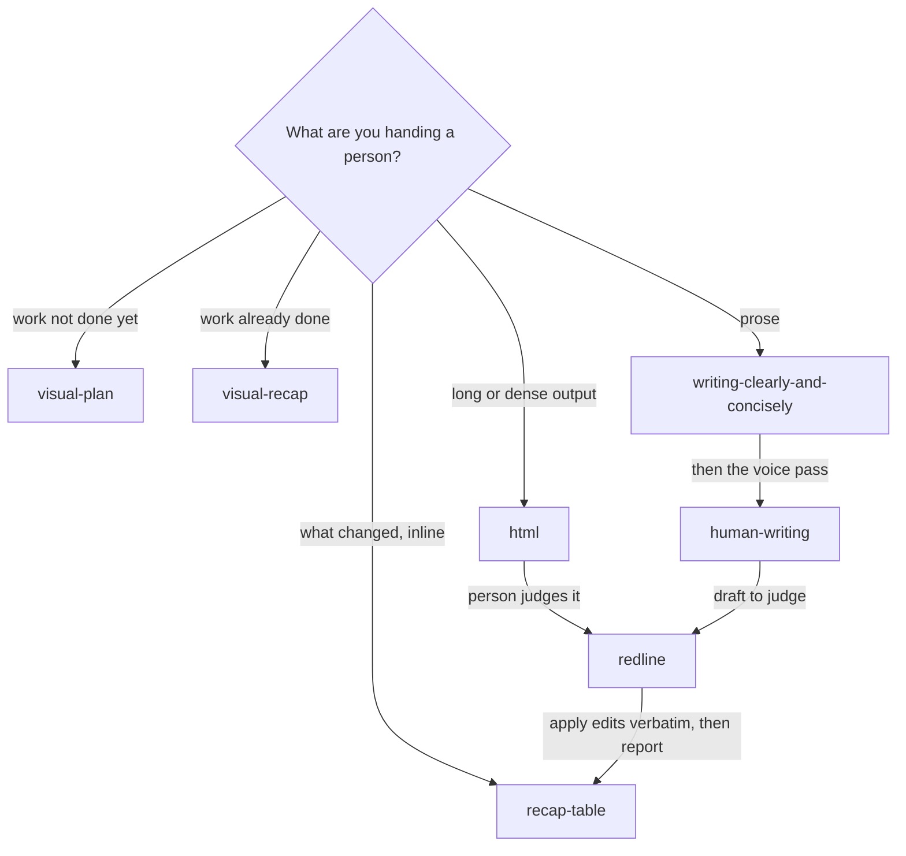

# Reporting & Comms

Seven skills for the last mile: turning what an agent produced into something a person actually wants to read — and getting their judgment back.

Agents are good at generating volume and bad at presentation. These skills cover both halves of the problem — the *format* (a self-contained HTML artifact, an interactive plan, a comparison table) and the *prose* (removing AI tells, corporate register, and padding).

Six of them run agent→human. `redline` runs the other direction: the human marks the artifact up in a browser and the agent applies what comes back.

---

## The skills

| Skill | Use it when |
|---|---|
| `html` | Output is complex enough that a wall of terminal text loses it — plans, code reviews, research, comparisons, configs, reports. Produces one self-contained, reading-first HTML file. |
| `visual-plan` | A text plan would land better as an interactive document: diagrams, file maps, annotated code, open questions, and UI review where it helps. |
| `visual-recap` | A PR, branch, commit, or diff needs explaining — renders it with diagrams, file maps, API and schema summaries, and annotated diffs. |
| `recap-table` | Someone asks "what did you change?" or wants a before/after comparison. Produces the table, not another paragraph. |
| `writing-clearly-and-concisely` | Any prose a human will read — docs, commit messages, error messages, explanations. Applies Strunk's rules and cuts what isn't carrying weight. |
| `human-writing` | Text reads as machine-generated: corporate speak, generic phrasing, the familiar AI cadence. Rewrites toward something conversational and specific. |
| `redline` | The human needs to judge a draft, plan, or report and describing the problems in chat is slower than fixing them. Opens it in a browser for direct editing and anchored comments; returns one Markdown review. |

---

## Rule ownership

Each concern has one owner, so seven skills don't all fire on the same prompt.

| Skill | Owns |
|---|---|
| `html` | Static report rendering — the single-file artifact and its layout |
| `visual-plan` | Forward-looking documents: plans, proposals, open questions |
| `visual-recap` | Backward-looking documents: what a diff, PR, or branch actually changed |
| `recap-table` | Tabular comparison — before/after, what-changed — inline, not a rendered page |
| `writing-clearly-and-concisely` | Concision and structure: cutting, ordering, sentence mechanics |
| `human-writing` | Register and voice: removing AI tells and corporate tone |
| `redline` | The return path — collecting a human's edits and anchored comments off a rendered artifact |

The pairing worth keeping straight: **`writing-clearly-and-concisely` decides what to cut; `human-writing` decides how what remains should sound.** Run them in that order — tightening after a voice pass usually undoes it.

`visual-plan` and `visual-recap` split on direction of time. If you want a page about work not yet done, that's `visual-plan`; work already done, `visual-recap`. `recap-table` is the lightweight alternative to either when a table answers the question.

Neither is offline. Local mode downloads `@agent-native/core` from npm and opens the hosted Plan page, which reads your plan from a bridge on your machine; nothing is published unless you ask.

`redline` splits from all six on **direction**, not subject. The others end when a person starts reading; `redline` starts there. It chains after any of them: render with `html`, mark up with `redline`, apply, repeat.

One rule crosses the pack and is worth stating once: **wording a human typed into a redline is final.** Neither prose skill may rewrite it, and no later editing pass may reflow it away. A skill that "improves" a human's own sentence has overruled the person the review existed to serve.

---

## What it looks like

<details>
<summary>Compatibility at a glance</summary>

| Skill | Claude Code | Claude app | Codex | ChatGPT | Other agents |
|---|---|---|---|---|---|
| html | ✔ | ✖ | ✔ | ◐ | ✔ |
| human-writing | ✔ | ✔ | ✔ | ✔ | ✔ |
| recap-table | ✔ | ✔ | ✔ | ✔ | ✔ |
| redline | ✔ | ✖ | ✔ | ✖ | ✔ |
| visual-plan | ✔ | ◐ | ✔ | ◐ | ◐ |
| visual-recap | ✔ | ◐ | ✔ | ◐ | ◐ |
| writing-clearly-and-concisely | ✔ | ✔ | ✔ | ✔ | ✔ |

✔ full · ◐ partial · ✖ no. What each host means, and the limits behind each mark: [Compatibility](../../README.md#compatibility).

</details>

Which skill to reach for depends on what you are handing a person. Prose gets the concision pass first and the voice pass second. `redline` brings the person's judgment back, and `recap-table` reports what their feedback changed.



Each example below is a short sample of a skill's output or a typical exchange. They use an invented project, a watering-tracker app called **Plant Ledger**. Every file, number, and sentence in them is made up.

<details>
<summary><code>html</code>: a summary page, laid out in order</summary>

[](../../README.md#compatibility) [](../../README.md#compatibility) [](../../README.md#compatibility)

> **Limits.** Claude app: The upload is rejected because of the `args` frontmatter key. ChatGPT: Can build the HTML file in the sandbox for download, without grounding in your repo.

Example output, invented data (fictional project). The outline of a summary page: under 200 body words, and a drawing in every section after the title.

```text
artifacts/html/sprint-summary.html            (one file, inline CSS, no network)

Plant Ledger: sprint 14 summary
  What this is: the state of the reminders rework at the end of the sprint

AT A GLANCE      [ 12 files ]   [ 3 of 4 tasks done ]   [ 1 blocked ]
BODY             flow drawing: schedule > reminder queue > push > phone
                 bar chart: reminders sent late, 9% before > 1% after
DECISIONS        ● Queue moved to a background job
                 ● Retries capped at 3
OPEN AND NEXT    ○ Travel mode: blocked on the time-zone fix
```

</details>

<details>
<summary><code>visual-plan</code>: from a request to a plan you approve</summary>

[](../../README.md#compatibility) [](../../README.md#compatibility) [](../../README.md#compatibility)

> **Limits.** Claude app: Hosted mode may work if the Plan MCP is added as a custom connector (unverified); no repo access, so the source must be pasted. ChatGPT: Hosted mode only if the Plan MCP can be added as a ChatGPT connector (unverified); no repo access. Other agents: Local mode needs a shell, npx, network and a browser; hosted mode needs the Plan MCP set up by hand, and the skill has no inline fallback.

Example exchange, invented data (fictional project).

```text
You:    /visual-plan add travel mode to the reminder settings

Agent:  Read the settings screen, the reminder action, and the schedule schema.
        Mode: UI-first. The top canvas shows 3 states: settings, travel-mode
        sheet, and the paused banner on the home screen.
        Hard-to-reverse decision called out: where the pause dates are stored.
        Wrote plans/travel-mode/ (local files), ran plan local check, then serve.
        Plan: <local bridge URL printed by serve>
        Open questions (bottom form): catch up missed waterings, or skip them?
        Touches: settings screen, reminder action, schedule table.
        Review it and approve before I write any code.
```

</details>

<details>
<summary><code>visual-recap</code>: the shape of a recap for a merged branch</summary>

[](../../README.md#compatibility) [](../../README.md#compatibility) [](../../README.md#compatibility)

> **Limits.** Claude app: Hosted mode may work if the Plan MCP is added as a custom connector (unverified); no repo access, so the source must be pasted. ChatGPT: Hosted mode only if the Plan MCP can be added as a ChatGPT connector (unverified); no repo access. Other agents: Local mode needs a shell, npx, network and a browser; hosted mode needs the Plan MCP set up by hand, and the skill has no inline fallback.

Example output, invented data (fictional project). Follows the skill's fixed order, top to bottom, and its budgets.

```text
Recap: travel mode for reminders                   (title, under 70 characters)
1 UI headline   before/after wireframes: settings screen, then the new sheet
                after-only: paused banner on the home screen
2 Narrative     2 paragraphs: why reminders pause, and the time-zone risk
3 data-model    schedules table: pause_start added, pause_end added
  api-endpoint  POST /schedules/{id}/pause (added)
4 file-tree     9 files: 6 modified, 3 added
5 Key changes   5 tabs, each a split diff with a one-line summary and notes
Not included    secrets in config: redacted as <redacted>
```

</details>

<details>
<summary><code>recap-table</code>: what changed, as a table</summary>

[](../../README.md#compatibility) [](../../README.md#compatibility) [](../../README.md#compatibility)

Example output, invented data (fictional project). One row for each change that actually moved.

| Area | Before | After |
|------|--------|-------|
| Reminder timing | Fired on a fixed daily timer | Fires at each plant's due time |
| Travel | Reminders kept firing while away | Paused, then caught up on return |
| Missed reminder | Silently dropped | Retried up to 3 times |

</details>

<details>
<summary><code>writing-clearly-and-concisely</code>: a sentence before and after Strunk's rules</summary>

[](../../README.md#compatibility) [](../../README.md#compatibility) [](../../README.md#compatibility)

Example edit, invented text (fictional project).

> **Before:** It should be noted that reminders were not able to be delivered by the system in a number of cases when the user was traveling.
>
> **After:** Reminders failed for some traveling users.
>
> Rules applied: 10 (use active voice), 11 (put statements in positive form), 13 (omit needless words).

</details>

<details>
<summary><code>human-writing</code>: a "humanize this" rewrite with its change list</summary>

[](../../README.md#compatibility) [](../../README.md#compatibility) [](../../README.md#compatibility)

Example exchange, invented text (fictional project).

```text
You:    humanize this: "We're thrilled to announce Travel Mode, a pivotal
        feature that seamlessly pauses your watering reminders while you're
        away, highlighting our commitment to plant lovers."

Agent:  Travel mode pauses your watering reminders while you're away.

        What changed:
        - cut "We're thrilled to announce" (enthusiastic opening)
        - cut "pivotal" and "seamlessly" (AI vocabulary, promotional)
        - cut "highlighting our commitment..." (trailing pseudo-analysis)
        - "Travel Mode" to "Travel mode" (title case)
        Kept: the one claim, unchanged. Nothing added.
```

</details>

<details>
<summary><code>redline</code>: the review file that Send returns</summary>

[](../../README.md#compatibility) [](../../README.md#compatibility) [](../../README.md#compatibility)

> **Limits.** Claude app: The upload is rejected because of the `args` frontmatter key, and the skill needs a local browser and your Downloads folder. ChatGPT: Needs a local browser page and your Downloads folder, with no stated fallback.

Example output, invented data (fictional project). Edits are the person's exact words and are applied verbatim. Comments are tied to a quote from the page.

```text
release-notes.redline.md

## Overall
Shorter. Lead with what users notice.

## Edits the human already made
### Lede
- before: Travel mode introduces a new paradigm for reminder scheduling.
- after:  Going away? Reminders now pause until you're back.

## Comments
### 1. Known issues
> may skip one watering across time zones
Say which time zones, or cut it.
```

</details>

---

## Install

### Claude Code

```
/plugin marketplace add stylusnexus/agent-plugins
/plugin install reporting-comms@stylus-nexus
```

Skills are namespaced: `/reporting-comms:html`, `/reporting-comms:redline`.

### Codex

```
codex plugin marketplace add stylusnexus/agent-plugins
codex plugin add reporting-comms@stylus-nexus
```

In Codex, type `$` and a skill name to use it (`$reporting-comms:html`; Codex prefixes plugin skills with the pack name), or run `/skills` to pick one.

### Everything else — Cursor, Copilot, Gemini CLI, Windsurf, Zed, opencode, Cline, Continue, Hermes, and ~60 more

```bash
npx skills add stylusnexus/agent-plugins --skill html human-writing recap-table redline visual-plan visual-recap writing-clearly-and-concisely
```

Skills arrive un-namespaced on this path, so most agents invoke them as `/html`, `/redline`; Windsurf uses `@html`, opencode shows `/html` only when the skill sets an opencode-specific metadata field, and Gemini CLI activates a skill itself after you approve it.

## License

MIT © Stylus Nexus Holdings LLC — see the [repository LICENSE](../../LICENSE).
