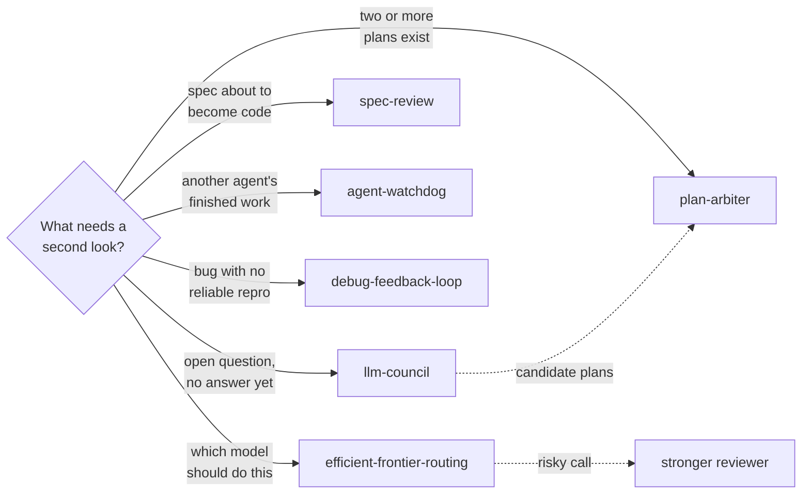

# Second Opinion

Six skills built on one premise: **a single model's confident answer is not evidence.**

Confidence and correctness are only loosely related, and an agent that is wrong is usually wrong fluently. These skills exist to introduce a second perspective before a decision hardens — whether that's a competing plan, an independent panel, a spec checked against reality, a bug reproduced before anyone theorises about it, or a stronger model brought in for the risky call.

---

## The skills

| Skill | Use it when |
|---|---|
| `llm-council` | A question, idea, or decision is consequential enough to want five advisors analysing it independently before synthesis — rather than one answer delivered confidently. |
| `plan-arbiter` | Two or more plans are on the table and someone has to compare, cross-review, merge, judge, or arbitrate between them. Picks on reasoning, not on whichever was written last. |
| `spec-review` | A spec or requirements doc is drafted or about to be implemented. Verifies its claims against the real codebase — catching wrong data-model assumptions before code embeds them. |
| `agent-watchdog` | Another agent's work needs watching, auditing, comparing, or fixing, from a session ID or transcript. |
| `debug-feedback-loop` | A bug needs a fast, deterministic pass/fail signal **before** hypothesising about causes — the step most debugging skips. |
| `efficient-frontier-routing` | Any task in Claude Code or Codex where the model should match the work: small tasks stay local, routine work goes to cheaper subagents, and difficult decisions or risky reviews go to a stronger one. |

---

## Rule ownership

| Skill | Owns |
|---|---|
| `llm-council` | Multi-advisor deliberation on an open question, and synthesis of their disagreement |
| `plan-arbiter` | Adjudication between competing *plans* that already exist |
| `spec-review` | Checking a written spec's factual claims against the codebase |
| `agent-watchdog` | Oversight of *another agent's* execution and output |
| `debug-feedback-loop` | Establishing reproduction before diagnosis |
| `efficient-frontier-routing` | Choosing which model tier handles each piece of work, the handoff packet sent to a subagent, and escalation to a stronger reviewer |

The distinction that matters: **`llm-council` opens a question, `plan-arbiter` closes one.** Reach for the council when you don't yet know the right shape of the answer and want genuinely independent takes; reach for the arbiter when candidate plans already exist and one has to win.

`spec-review` is the cheapest check here and catches the most expensive class of error — a spec that assumes a table, column, or relationship that isn't there. That assumption survives review because reviewers read the spec, not the schema.

`efficient-frontier-routing` decides which model does each piece of work; the other five check whether the work is right. Its escalation step is where they meet: a risky decision from a cheaper session goes to a stronger reviewer with the evidence, not a bare verdict.

---

## What it looks like

Which second opinion to ask for:



What each one hands back:

| Skill | Returns | Scale |
|---|---|---|
| `spec-review` | Verdict plus findings with `file:line` evidence | SHIP · SHIP WITH CHANGES · DO NOT SHIP; findings CRITICAL · HIGH · MEDIUM · LOW |
| `plan-arbiter` | One decision memo | Adopt · Hybrid · Revise first |
| `agent-watchdog` | A gap report | Each issue is a Gap · Bug · Verification miss · Scope drift · No issue |
| `llm-council` | A chairman's verdict and an HTML report | One recommendation and one first step, never "it depends" |
| `debug-feedback-loop` | A pass/fail loop and ranked hypotheses | Each hypothesis states what change would make the bug disappear |
| `efficient-frontier-routing` | Which model ran each step | Fast extraction · scoped coding · strong reasoning |

Each skill below has one collapsed example. All data in them is invented.

<details>
<summary><b>llm-council</b> · five advisors, one verdict</summary>

*Example output, invented data.*

```text
Question: free tier or 14-day trial for a small analytics tool?

Positions          Free tier   Trial   Reframe
Contrarian                      x
First Principles                         x   "who actually converts?"
Expansionist          x
Outsider                        x
Executor                        x

## Where the Council Agrees     the trial's deadline drives the decision to pay
## Where the Council Clashes    reach (free tier) against support load (trial)
## Blind Spots the Council Caught
   the Outsider could not tell from the pricing page what the tool does
## The Recommendation           ship the 14-day trial; revisit a free tier later
## The One Thing to Do First    rewrite the pricing page headline around the outcome

Files: council-report-<timestamp>.html, council-transcript-<timestamp>.md
```

</details>

<details>
<summary><b>plan-arbiter</b> · comparison and decision memo</summary>

*Example output, invented data.*

```text
| Tie-break order          | Plan A                   | Plan B                          |
| 1 Fits the request       | yes                      | yes, plus an admin UI not asked |
| 2 Grounded in real code  | names real files         | assumes a job queue that is not there |
| 3 Simpler first step     | one migration            | two new services                |
| 4 Validation, rollback   | no rollback story        | feature flag and backfill test  |
| 5 Execution cost         | low                      | medium                          |

Decision      Hybrid
Why           A is grounded and simpler; B has the better rollback path.
Execution     1 migration  2 service change behind a flag  3 backfill  4 remove flag
Borrowed      B's feature flag and backfill dry run
Rejected      B's admin UI (not requested); B's job queue (does not exist)
Verification  migration test, backfill dry run, CI green
Executor      a cheaper coding model: the plan is concrete and bounded
```

</details>

<details>
<summary><b>spec-review</b> · second-model verdict checked against the code</summary>

*Example output, invented data.*

```text
CODEX SPEC REVIEW: docs/specs/2026-01-10-team-billing-design.md
Verdict: DO NOT SHIP

[CRITICAL] §3 Data model: treats invoice.team_id as one team. The schema has an
           invoice_teams join table (many-to-many). Evidence: prisma/schema.prisma:212
[HIGH]     §5 Acceptance: "refunds work" has no measurable criterion.
[MEDIUM]   §4 says proration is on; §6 says it is off.
[LOW]      §7 migration is not idempotent (no IF NOT EXISTS).

Verified OK
- users.role exists (prisma/schema.prisma:40)
- POST /api/invoices exists (app/api/invoices/route.ts:9)
```

DO NOT SHIP still exits `0`: the exit code says whether the review ran, not what it concluded.

</details>

<details>
<summary><b>agent-watchdog</b> · audit of another agent's run</summary>

*Example output, invented data.*

```text
Status          Done
Requested       Add CSV export to the reports page, with a test; no schema changes.
Observed        Export button and route added; agent says "all tests pass".
Gaps
  Bug                export route skips the team filter (app/api/reports/export.ts:22)
  Verification miss  claimed test run not in the transcript; CI shows 1 failing test
  Scope drift        renamed two unrelated helpers in lib/format.ts
Fixes made      (audit only, none)
Remaining risk  CI red until the failing test is fixed; rename needs a decision.
```

</details>

<details>
<summary><b>debug-feedback-loop</b> · build the loop, then rank hypotheses</summary>

*Example exchange, invented data. This skill runs only when you invoke it.*

```text
You:   /debug-feedback-loop  Checkout total is sometimes off by one cent.

Agent: Loop: property loop (ladder step 7), 1000 random carts against the
       totals function, seeded. Reproduces 31 of 1000 in 2 seconds.

       Hypotheses, ranked, before testing any:
       1. If float rounding is the cause, integer cents makes all 31 disappear.
       2. If discount order is the cause, applying tax first changes the count.
       3. If currency conversion is the cause, a USD-only run drops to 0.

       Probes tagged [DBG-a4f2]; one grep removes them after the fix.
       Regression test goes in before the fix, at the totals seam.
```

</details>

<details>
<summary><b>efficient-frontier-routing</b> · which model ran each step</summary>

*Example output, invented data.*

```text
Task: fix failing checkout tests, tighten the refund rule
Preferences: discovery Haiku · implementation Sonnet · risky review Opus (high)
             · at most 2 subagents at once

Step                                   Ran on              Why
Run suite, cluster failures            Haiku subagent      discovery
Map where refund logic lives           Haiku subagent      discovery
Fix stale fixture                      main session        too small to hand off
Review refund change before editing    Opus, effort high   billing is high-risk
Apply change, rerun tests, reopen      main session        verify, don't forward
  the two files the reviewer flagged
```

</details>

---

## Install

### Claude Code

```
/plugin marketplace add stylusnexus/agent-plugins
/plugin install second-opinion@stylus-nexus
```

Skills are namespaced: `/second-opinion:plan-arbiter`.

### Codex

```
codex plugin marketplace add stylusnexus/agent-plugins
codex plugin add second-opinion@stylus-nexus
```

In Codex, type `$` and a skill name to use it (`$second-opinion:plan-arbiter`; Codex prefixes plugin skills with the pack name), or run `/skills` to pick one.

### Everything else — Cursor, Copilot, Gemini CLI, Windsurf, Zed, opencode, Cline, Continue, Hermes, and ~60 more

```bash
npx skills add stylusnexus/agent-plugins --skill agent-watchdog debug-feedback-loop efficient-frontier-routing llm-council plan-arbiter spec-review
```

Skills arrive un-namespaced on this path, so they invoke as `/plan-arbiter`.

## Prerequisites

- **Multiple model access** for `llm-council` — the value comes from advisors that genuinely differ, so pointing all five at one model defeats the purpose.
- **`git`** and repository access for `spec-review`, which reads the codebase rather than trusting the spec's description of it.
- **Per-agent model selection** for `efficient-frontier-routing` — on a host that exposes only one model, it keeps work on that model and reports any stronger review it could not run.

## License

MIT © Stylus Nexus Holdings LLC — see the [repository LICENSE](../../LICENSE).
