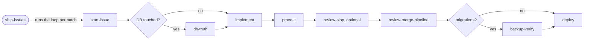

# Ship Pipeline

Fifteen repo-agnostic skills for the ship half of the development loop — from reading the issue to promoting to production, with evidence at every gate.

Every skill detects the repository's own conventions rather than assuming a house style. The shipping-loop skills (`start-issue` through `ship-issues` in the table below) **defer to a repo-local version of themselves** when the project defines one (`.claude/skills/<name>/`), and `review-merge-pipeline` defers to a repo-local release runbook. Install it globally; override it per-repo where a project has stronger rules.

---

## The loop

| Phase | Skill | What it does |
|---|---|---|
| **Intake** | `start-issue` | Reads the full issue — body *and* comments, where scope changes hide. Checks whether the work already shipped, captures a baseline, branches off the detected integration branch. |
| **Ground** | `db-truth` | Verifies schema claims against the live database before you design against them, and confirms migrations actually landed after you apply them. |
| **Verify** | `prove-it` | End-of-work evidence protocol. Discovers what CI *actually* gates, runs both static gates, checks threaded values at their terminus, does one real round-trip, and emits a claim→command→result table. |
| **Inspect** | `review-slop` | Reports needless complexity, validation gaps, misleading test coverage, and prose problems with evidence and acceptance criteria. Makes no edits. |
| **Ship** | `review-merge-pipeline` | One shot: verify → review → fix → commit → push → PR → merge. Detects the merge target instead of assuming one. |
| **Promote** | `deploy` | Integration branch → production, with the repo's own merge strategy inferred from its history. |
| **Batch** | `ship-issues` | Carries a set of issues through the loop above in one run: grounds and groups them, reports status before any edit, then calls `start-issue`, `prove-it` and `review-merge-pipeline` per group. For a ship/deploy/release request it also runs `deploy` once for the whole batch and validates against production; for an "implement and merge" request it stops after the merges. |
| **Schema** | `db-migration-safety` | Expand-contract migrations, idempotent SQL, batched backfills. |
| **Schema** | `backup-verify` | Confirms backups exist **and actually restore** — into a scratch branch, with smoke queries and timestamped evidence. |
| **Build** | `api-design` | REST conventions for Next.js route handlers — resource naming, versioning, cursor pagination, one error envelope, Zod validation, and OpenAPI generated from Zod. |
| **Build** | `stripe-billing` | Stripe subscriptions in a Next.js app — Checkout, customer portal, signed and idempotent webhooks, proration, trials, and dunning. |
| **Build** | `feature-flags` | Flag lifecycle with PostHog as the worked backend — naming, rollout flag versus kill switch, staged rollout, both code paths tested, and a stale-flag cleanup that removes code before disabling the flag. |
| **Build** | `analytics-instrumentation` | PostHog event taxonomy and instrumentation review — naming, flat properties, identify/reset/group, PII exclusion, and a starter dashboard set. |
| **Review** | `ux-review` | Reads screenshots (Playwright visual snapshots or any folder) and rates each against a UX checklist — layout, spacing, hierarchy, consistency, accessibility, mobile. Reports findings; files GitHub issues only when you ask. |
| **Output** | `cdf` | Prints a list of GitHub issues as one plain comma-separated line of numbers, nothing else. |

### Why `prove-it` is not "trust but verify"

Trust-but-verify presumes a claim is sound and spot-checks it. `prove-it` inverts the burden of proof: nothing is done until a command's output backs it, and anything unprovable is stamped `UNVERIFIED` rather than assumed fine. The premise is uncomfortable — features that passed build, typecheck, tests, review, *and* deploy, and were still dead in production, because no gate ever exercised a real write.

> An honest `UNVERIFIED` outranks a confident guess.

---

## Rule ownership

Each concern lives in exactly one skill. When a task crosses domains, the owner below keeps the rule and the others name only the handoff — this is what stops fifteen skills from firing on the same prompt.

| Skill | Owns |
|---|---|
| `start-issue` | Issue comprehension, prior-art checking, baseline capture, branch naming |
| `db-truth` | **Reading** schema truth — shape, relationships, permissions, and post-apply confirmation |
| `db-migration-safety` | **Writing** schema change — expand-contract sequencing, idempotency, backfills |
| `backup-verify` | Backup existence and restore-testing; the go/no-go before a risky mutation |
| `prove-it` | Evidence standards, gate discovery, the evidence table, `UNVERIFIED` labeling |
| `review-slop` | Report-only slop findings, severity calibration, and suggested repair criteria |
| `review-merge-pipeline` | Review orchestration, commit/push/PR mechanics, merge-target detection, head-SHA and required-check confirmation before merge |
| `deploy` | Production promotion, merge strategy, release-tooling compatibility |
| `api-design` | Route handler conventions — resource naming, versioning, pagination, the error envelope, Zod request/response validation, status codes, generated OpenAPI, and response scrubbing |
| `stripe-billing` | Subscription billing code — Checkout Sessions, customer portal, plan changes and proration, trials, dunning, and the signed, idempotent Stripe webhook handler |
| `feature-flags` | Flag lifecycle — naming, rollout versus kill switch, rollout stages, kill-switch alerts, testing both paths, and stale-flag cleanup |
| `analytics-instrumentation` | PostHog event taxonomy — `object_verb` naming, property schemas, identify/reset/group calls, PII exclusion, LLM usage events, and the starter dashboards |
| `ux-review` | Visual UX review of screenshots — the checklist, per-screenshot ratings and severities, and opt-in issue filing that follows the repo's own labels and templates |
| `cdf` | Output format for issue lists — one comma-separated line of numbers, nothing added |
| `ship-issues` | Batch orchestration — per-issue status, grouping into branches, consult-before-asking, post-deploy validation, the batch report. Owns no step the skills above own. |

`ux-review` judges what a screenshot shows; it is not a full accessibility audit. A screenshot cannot prove contrast ratios, focus order, or label associations, so it flags likely accessibility problems and leans on axe (when installed) to confirm them. `readiness-review` in the `hardening` pack can also report accessibility findings, but as one category of a code-level launch-readiness verdict, not from screenshots.

`feature-flags` owns flag lifecycle; `analytics-instrumentation` owns the events that tell you whether a rollout step is healthy.

`stripe-billing` owns the Stripe webhook handler, including its signature check and idempotency. For webhook delivery in general, use `webhook-reliability` from the `hardening` pack. `api-design` owns route shape and error envelopes; `auth-hardening` (also in `hardening`) owns who may call a route.

The three database skills are the pairing most worth keeping straight: **`db-truth` reads, `db-migration-safety` writes, `backup-verify` is the safety net before either touches production.**

---

## What it looks like

How the shipping skills chain for one issue. `ship-issues` runs the same loop for a batch.



Open a skill below to see a short sample of what it produces. Every sample is invented: the repos, issue numbers, files and figures are made up.

<details>
<summary><code>start-issue</code>: the intake packet</summary>

Example output, invented data.

```text
Running /start-issue intake for #412.

INTAKE #412 — PDF export fails for long documents
Goal: export succeeds for documents of any length
In scope: export payload limit   Out of scope: export styling (#398)
Done when: a 120-page document exports; a real failure shows an error
Already-shipped check: searched PRs and issues for "412" and "export"; nothing merged. Not shipped.
Premise check: issue is fresh (4 days old); the 30-page limit is still in the code
Branch: fix/412-long-pdf-export   Baseline: 3 typecheck errors
DB touched: no
Test cases (plain English):
  - a 5-page document still exports
  - a 120-page document exports
  - a failed export shows an error instead of doing nothing
Plan next: inline plan
```

</details>

<details>
<summary><code>db-truth</code>: a pre-work check that stops a wrong spec</summary>

Example exchange, invented data.

```text
> /db-truth pre-work   (before planning a "project owner" badge)

Running /db-truth pre-work verification.
Live schema:
  projects:        id uuid, name text, created_at timestamp     (no owner column)
  project_members: project_id uuid, user_id uuid, role text
Relationships:
  project ↔ user: M2M through project_members, not a scalar owner_id
Permissions: project_members has no INSERT policy for the new role
Call site named in the plan: src/projects/badge.ts:41 (confirmed by grep)
Verdict: the spec's "project.owner_id" does not exist. Stopping.
Revise the data model to read role = 'owner' from project_members.
```

</details>

<details>
<summary><code>prove-it</code>: the evidence table</summary>

Example output, invented data.

```text
Running /prove-it verification.

| # | Claim                         | Command / location                     | Result      |
|---|-------------------------------|----------------------------------------|-------------|
| 1 | Types clean (baseline 3→3)    | npm run typecheck                      | PASS        |
| 2 | Build passes                  | npm run build                          | PASS        |
| 3 | New behavior tested           | export.test.ts (fails without the fix) | PASS        |
| 4 | Page count reaches the worker | worker.test.ts asserts pages = 120     | PASS        |
| 5 | Real write and read-back      | POST /api/export, then GET the file    | PASS        |
| 6 | Renders at /documents/[id]    | export.spec.ts, console clean          | PASS        |
| 7 | Works in mobile Safari        | —                                      | UNVERIFIED  |

7: no device available here; needs one run on a real phone.
```

</details>

<details>
<summary><code>review-slop</code>: report-only findings</summary>

Example output, invented data.

```text
Scanned: 9 files, origin/dev (a1b2c3d)...HEAD (e4f5a6b). Not scanned: 1 unstaged file.

HIGH
- Location: src/export/worker.ts:88
  What: cast to any on the job payload; ExportJob is one import away
  Why it matters: a renamed field still compiles and fails at runtime
  Suggested fix: type the payload as ExportJob (not applied)
  Evidence: ExportJob in src/export/types.ts:12; only caller queue.ts:40
  Acceptance: renaming ExportJob.pages breaks the typecheck

WARNING
- Location: docs/export.md:5
  What: "seamlessly handles any document", but exports stop at 500 pages
  Suggested fix: state the limit

Counts: CRITICAL 0 · HIGH 1 · WARNING 1
Open question: is the 500-page limit intended?
```

</details>

<details>
<summary><code>review-merge-pipeline</code>: how review findings are handled, and the final report</summary>

What happens to each review finding, by the reviewer's confidence:

| Confidence | Action |
|---|---|
| 90-100 (Critical) | Must fix before going further |
| 80-89 (Important) | Fix, unless it is a pre-existing pattern or out of scope |
| Below 80 (Minor) | Skip; note it in the PR description if relevant |

Example output, invented data.

```text
Running the review-merge pipeline.
...
Pipeline complete:
- PR: example-org/notes-app#233
- Status: Merged to dev
- Review: 3 issues found, 2 fixed (1 minor, noted in the PR)
```

</details>

<details>
<summary><code>deploy</code>: sizing a deploy, and the final report</summary>

After a squash deploy, the file diff can show work that already shipped. The skill reads both signals together:

| File diff | New commit list | Read it as |
|---|---|---|
| Tiny | Huge | Phantom diff; trust the file diff |
| Huge | Tiny | Trust the commit list; the PR title describes only those commits |
| Large | Large | Genuinely large |
| Small or empty | Small or empty | Minimal; abort if there is nothing |

Example output, invented data.

```text
Deploy complete:
- Repo / PR: example-org/notes-app #240
- Files changed: 14 (+412/-96)
- Version: 2.8.0
- Publishes: none
- Migrations: applied 20261014_add_export_jobs
- Host: auto-deploys from main
```

</details>

<details>
<summary><code>ship-issues</code>: the grounding report before any edit</summary>

Example output, invented data.

```text
Running /ship-issues for #412, #415, #420.

Base: dev = 7c1e9a0, main = 3b4d2f8 (verified via gh). Unreleased on dev: yes, 2 PRs.
Goes live on merge? no — the host deploys from main only (render.yaml)
| Issue | Status         | What's left                           |
| #412  | Open work      | everything                            |
| #415  | Partly shipped | PR #402 added the API; the UI is left |
| #420  | Shipped        | PR #398 on main, checked live         |
Groups: export → #412, #415 → fix/412-export-limits
Dependencies / blocked: none
Decisions needing consultation: should the page limit be per plan?
```

</details>

<details>
<summary><code>db-migration-safety</code>: the expand-contract sequence</summary>

Each phase is its own migration and its own deploy:

| Phase | What ships | Old code still works? |
|---|---|---|
| 1. Expand | New column or table, nullable or with a default, additive only | Yes |
| 2. Backfill | Existing rows filled in small batches, alongside live traffic | Yes |
| 3. Migrate reads and writes | App code writes to, then reads from, the new shape | Both shapes coexist briefly |
| 4. Contract | Drop the old column, add `NOT NULL`, once the backfill is confirmed | Only after every instance runs the new code |

Collapsing phases 1 and 4 into one migration is the most common cause of an avoidable outage. Phase 4 waits for a confirmed backup from `backup-verify`.

</details>

<details>
<summary><code>backup-verify</code>: the restore-drill evidence</summary>

Example output, invented data.

```text
Backup mechanism: Neon point-in-time restore plus snapshots
Backup used: snapshot snap-0412, taken 2026-10-14 03:00 UTC
Restore drill: 2026-10-14 09:20 UTC into branch backup-drill-20261014
  neon snapshots restore snap-0412 --name backup-drill-20261014

Row counts      restored   live now
  User            18,204     18,231
  Subscription     4,112      4,115
  Customer         4,090      4,093
Newest Subscription row: 02:58 UTC (just before the backup)
Orphaned subscriptions: 0
Differences match writes made after 03:00 UTC.

Result: PASS. Scratch branch deleted.
```

</details>

<details>
<summary><code>api-design</code>: a route review against the checklist</summary>

Example exchange, invented data.

```text
> /api-design review app/api/projects

- app/api/projects/route.ts:22   findMany() with no select returns the owner's
  passwordHash. Blocking: choose fields with select at the query.
- app/api/projects/route.ts:9    limit comes from the query string with no cap.
  Cap it at 100 on the server.
- app/api/projects/[projectId]/route.ts:31   returns 403 for another user's
  private project, which confirms it exists. Return 404.
- app/api/projects/[projectId]/route.ts:47   returns 200 with { "error": ... }.
  Use the error envelope with code NOT_FOUND and status 404.
Holds: plural nested paths, no version prefix, Zod input validation,
  OpenAPI regenerated in this PR.
Verdict: FAIL (a sensitive field is returned).
```

</details>

<details>
<summary><code>stripe-billing</code>: webhook evidence</summary>

Example output, invented data.

```text
Handled: checkout.session.completed, customer.subscription.created,
  customer.subscription.updated, customer.subscription.deleted,
  invoice.paid, invoice.payment_failed, customer.subscription.trial_will_end
Not handled, on purpose: invoice.upcoming
Idempotency: event.id inserted into WebhookEvent (unique) in the same
  transaction as the state change

$ stripe trigger customer.subscription.updated
  before: status=trialing  priceId=price_basic
  after:  status=active    priceId=price_pro
$ stripe events resend evt_test_0412
  WebhookEvent rows before: 1   after: 1   (nothing written twice)
Handler forced to throw → 500; resend → 200, row written once
Client-supplied Stripe IDs trusted anywhere: none found
```

</details>

<details>
<summary><code>feature-flags</code>: the stale-flag cleanup table</summary>

Example output, invented data.

```text
Stale-flag cleanup
name                         rollout   last evaluated   action
editor-ai-summary            100%      today            remove code, deploy, then disable
billing-annual-plan-prompt   100%      41 days ago      remove code, deploy, then disable
kill-ai-summary-generation   on        today            keep (kill switch)
search-beta                  disabled  —                no owner or history: ask first

One cleanup PR per flag. The flag is disabled only after the PR
that removes its code has deployed.
```

</details>

<details>
<summary><code>analytics-instrumentation</code>: an audit of existing events</summary>

Example output, invented data.

```text
Capture calls found: 31 (rg -n "posthog\.capture\(")

PII in capture() properties: 2 hits
  src/share/dialog.tsx:58   project_shared { email: invitee.email }
  src/search/bar.tsx:21     search_submitted { query: input.value } (raw user input)
Names that break object_verb: 3, with a rename plan
  created_project     → project_created
  button_clicked      → project_export_clicked
  project_created_v2  → project_created plus a version property
identify(): on signup ✓, on login ✗ (src/auth/login.ts)
reset() on logout: ✓
Result: FAIL. The PII is already in production, so this goes to the
project owner (fix plus possible deletion of past events).
```

</details>

<details>
<summary><code>ux-review</code>: one screenshot's rating and the summary</summary>

Example output, invented data.

```text
### settings-mobile.png
**Rating:** 🟡 Needs Attention

**Issues:**
- [Major] Save button sits below the fold on a 390px screen — move it into a sticky footer
- [Minor] Section headers and body text are the same weight — make headers bolder

**Positives:**
- Form fields stack cleanly with visible labels

UX Review Complete:
- Screenshots reviewed: 6
- 🟢 Good: 4   🟡 Needs Attention: 1   🔴 Needs Fix: 1
- Issues filed: 0 — not filed; reply 'file issues' to file them
```

</details>

<details>
<summary><code>cdf</code>: issue numbers as one line</summary>

Example exchange, invented data.

```text
> which of 101, 205, 318 and 422 are still open? /cdf

101, 318

> open vs closed /cdf

Open: 101, 318
Closed: 205, 422
```

</details>

---

## Install

### Claude Code

```
/plugin marketplace add stylusnexus/agent-plugins
/plugin install ship-pipeline@stylus-nexus
```

Plugin skills are namespaced: `/ship-pipeline:prove-it`, `/ship-pipeline:deploy`, and so on.

### Codex

```
codex plugin marketplace add stylusnexus/agent-plugins
codex plugin add ship-pipeline@stylus-nexus
```

In Codex, type `$` and a skill name to use it (`$ship-pipeline:prove-it`; Codex prefixes plugin skills with the pack name), or run `/skills` to pick one.

### Everything else — Cursor, Copilot, Gemini CLI, Windsurf, Zed, opencode, Cline, Continue, Hermes, and ~60 more

```bash
npx skills add stylusnexus/agent-plugins            # pick interactively
npx skills add stylusnexus/agent-plugins --skill analytics-instrumentation api-design backup-verify cdf db-migration-safety db-truth deploy feature-flags prove-it review-merge-pipeline review-slop ship-issues start-issue stripe-billing ux-review  # this pack
```

The [Skills CLI](https://github.com/vercel-labs/skills) detects which agents you have installed and writes to each one's skills directory. Skills arrive un-namespaced here, so they invoke as `/prove-it` rather than `/ship-pipeline:prove-it`.

---

## Prerequisites

The skills shell out to standard tooling; install what your workflow touches:

- **`git`** and **`gh`** (authenticated via `gh auth login`) — issue intake, PR creation, merging
- **A typecheck and build command** — discovered from the repo, not assumed
- **Database CLI** *(only for the schema skills)* — `psql`, the Supabase CLI, or the Neon CLI, depending on your stack

## Safety notes

- `ship-issues` runs the whole loop for every issue you pass it, but "the whole loop" depends on how you ask: a ship/deploy/release request merges the batch AND deploys it to production; an "implement and merge" request stops after the merges and does not run `deploy` — though merged code may already be live if your host deploys from the branch it merged into. Either way it never bypasses a failing or missing required check.
- `review-merge-pipeline` merges pull requests. Read it before first use, and pass `--no-merge` to stop at PR creation while you get a feel for it.
- `deploy` promotes to production. It fast-forwards local refs and compares against fresh upstream state before acting.
- `backup-verify` and `db-migration-safety` are deliberately conservative: they print the affected scope before any destructive step.

## License

MIT © Stylus Nexus Holdings LLC — see the [repository LICENSE](../../LICENSE).
